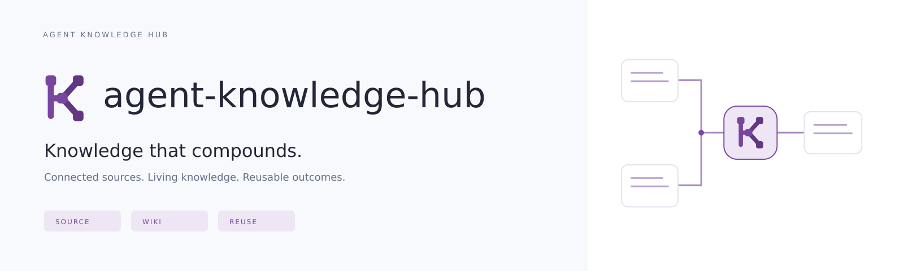

# agent-knowledge-hub

<picture>
  <source media="(prefers-color-scheme: dark)" srcset="brand-kit/readme-banner-dark.svg">
  
</picture>

LLM으로 만든 업무 산출물을 근거와 함께 사내 지식에 연결하고, 사람이 검토한 변경을 발행하는 앱입니다. Ingest·Query·Lint로 연결된 위키를 축적하는 **실행 가능한 로컬 데모**이며 사내 레포에서 계속 개발하기 위한 출발점입니다.

장기 목표는 Karpathy의 LLM Wiki 패턴에 기반한 **Agent-Native Knowledge & Experience Platform**입니다. LLM이 원천 정보와 업무 경험을 기존 지식에 통합·연결·검증·갱신하고, 에이전트의 활용 결과가 다시 지식 개선으로 이어지는 순환을 지향합니다. 문서 수 증가가 아니라 근거와 적용 조건의 정확성, 후속 업무의 검증 가능한 개선으로 발전을 판단합니다. [North Star](docs/LLM_WIKI_CORE.md)에서 원전·프로젝트 확장·현재 구현을, [평가 계약](docs/EVALUATION.md)에서 앞으로 검증할 방법을 구분합니다. 이 목표 기능이 모두 구현된 것은 아닙니다.

## 패키지의 데모를 바로 보기

압축본에는 빌드된 `demo-dist/`도 포함돼 있습니다. Node.js만 설치돼 있다면 의존성 설치 없이 실행할 수 있습니다.

```bash
npm run demo
```

http://127.0.0.1:8080 을 엽니다. `AGENT_KNOWLEDGE_HUB_DEMO_PORT` 환경변수로 포트를 바꿀 수 있습니다. 이 실행기는 로컬 시연용이며 프로덕션 웹서버가 아닙니다.

## 소스에서 개발하기

Node.js **22.12 이상인 22.x 또는 24.x LTS**와 npm 10 이상이 필요합니다. Node 24를 권장하며 `.nvmrc`로 선택할 수 있습니다. 의존성 버전은 package-lock.json에 고정돼 있습니다.

```bash
npm ci
npm run doctor
npm run check
npm run dev
```

터미널에 표시되는 주소를 브라우저에서 엽니다. 기본 Vite 포트는 5173입니다. 빌드 결과는 `npm run build`, 빌드 미리보기는 `npm run preview`로 확인합니다. 정적 빌드는 `dist/`에 생기며 파일을 더블클릭하는 대신 HTTP 서버로 제공하세요.

내부 npm 미러와 프록시·CA를 사용한다면 회사 표준 설정을 적용하세요. TLS 검증을 끄는 설정은 포함하지 않았습니다. 웹폰트 CDN이나 외부 이미지·서비스를 런타임에 호출하지 않습니다. Pretendard 및 D2Coding이 설치돼 있으면 사용하고, 없으면 시스템 폰트로 표시됩니다.

OS별 설치·집중 테스트·모델 없는 개발·포트 충돌·PR CI와 배포 한계는 [개발 가이드](docs/DEVELOPMENT.md)를 참고하세요. 기본 검사에는 모델 키나 Docker가 필요하지 않습니다.

## 핵심 순환 데모

1. **지식 컴파일 → 자료 편입 → 원본 등록**: 준비된 산출물을 등록합니다. 제목과 본문을 직접 바꿔도 됩니다.
2. **선택 자료 편입**: 주제 1개와 개념 2개의 변경 집합을 생성합니다. 각 페이지를 펼쳐 현재·제안 전체 내용을 비교합니다.
3. **변경 집합 승인 → 승인 집합 전체 발행**: 기존 주제와 새 개념 페이지·연결을 함께 발행합니다.
4. **질문과 축적 → 위키에 질문**: 발행본 버전과 정확한 인용이 표시됩니다. **답변을 위키로 편입**하고 승인·발행하면 질문 결과가 새 페이지로 남습니다.
5. **자료 편입 → 상충 자료 예시 등록 → 편입·승인·발행**을 실행한 뒤 **주간 점검 → Weekly 점검 실행**: 동일 조건의 서로 다른 사실을 실제 데이터에서 찾습니다.
6. **지식 인덱스**에서 페이지·근거·연결을 보고 새로고침해 상태 유지를 확인합니다.

기본은 오프라인 구조 편입·발행본 발췌이며 자연어 의미 추론을 하지 않습니다. **실제 모델 연결 코드**도 포함하며, .env.example을 복사해 URL·모델·서버 키를 설정하고 `npm run demo`를 재시작한 뒤 실행 엔진을 선택합니다. [모델 연결 가이드](docs/MODEL_SETUP.md)를 따르세요. 모델 오류를 성공으로 처리하거나 오프라인 결과로 숨기지 않습니다.

문서 보기에서 버전 기록·복원·공유 링크도 시연할 수 있습니다. 같은 브라우저의 상태를 저장하며 설정에서 초기화합니다.

## 실제로 구현한 범위

- 문서 탐색, 본문·태그 검색, 공간 필터, 즐겨찾기, Markdown 렌더링
- 합성 산출물 원본, 수동 등록, 공개 범위의 기본 일관성 검사
- 구조 기반·실제 모델 편입 경로, 여러 페이지의 변경 집합과 연결, 원본 보존
- 발행본 질문·인용 고정 버전·답변 재편입, 실제 구조 및 명시 사실 Lint
- 문서별 변경안 비교, 검토자 승인·반려·발행, 기준 버전 충돌 차단
- 문서 편집과 버전 기록·복원, 근거 연결과 재사용 피드백
- 같은 브라우저 안에서의 공유 링크 생성·버전 고정·만료·철회
- 로컬 활동 기록·JSON 내보내기, 라이트·다크 테마, 반응형 레이아웃
- 기준 239개 + 핵심 순환 12개 수용 기준과 로드맵, 개발·런타임 에이전트 문서

## 데모와 프로덕션의 경계

**기본 실행은 모델 미연결입니다. 선택적 모델 중계 서버 코드는 제공하지만 실제 사내 모델 품질은 미검증입니다. SSO, 서버 저장소, 보안 ACL, 상시 스케줄러, 커넥터, MCP 서버는 미구현입니다.** 모든 자료와 이름은 합성 예시입니다. 브라우저 역할 전환은 화면과 도메인 동작 시연이며 보안 경계가 아닙니다. 이 정적 앱을 민감한 사내 데이터로 운영하면 안 됩니다.

새 매니저는 여러 페이지의 편입 집합과 실제 규칙 점검을 수행합니다. 오프라인 모드는 `## 지식:` 및 `사실:` 형식의 자료를 읽고 질문에는 발행본을 발췌합니다. 자연어 전반의 의미 충돌 탐지와 원본의 진위 검증은 수행하지 않습니다. 일정은 설정만 저장합니다. 수동 문서 편집은 기존 데모에서 새 버전으로 즉시 발행됩니다. 새 변경 집합은 승인과 발행을 분리합니다.

카파시 원전과 현재 구현의 관계, 세 층과 남은 차이는 [LLM_WIKI_CORE.md](docs/LLM_WIKI_CORE.md)에 있습니다. MCP는 연결 수단이며 핵심 지식 누적 순환을 대신하지 않습니다.

공유 링크는 데이터를 서버에 전송하지 않아 다른 브라우저나 사용자에게 문서를 전달하지 못합니다. localStorage를 지우면 함께 사라집니다. 매니저 실행 중 새로고침하면 진행이 취소될 수 있으며 지속 작업 실행은 로드맵입니다.

## 사내 컴포넌트 재사용

agent-admission-gate의 실제 소스는 포함하지 않았습니다. 기존 브랜드 원본에서 확인한 plum 4개 색상을 유지하고, 공통 UI 교체 경계를 만들었습니다.

- `src/ui/primitives.tsx`: Button·Badge·Modal·Empty 교체 지점
- `src/ui/tokens.css`: 색상·폰트·간격·모서리의 의미 토큰
- `src/adapters/repository.ts`: 로컬 저장소를 서버 클라이언트로 교체할 경계
- `src/domain/`: UI와 독립적인 상태·전이·검증 규칙

실제 이식 절차와 대응표는 [UI_INTEGRATION.md](docs/UI_INTEGRATION.md)에 있습니다. 기존 Gate 레포의 규칙과 컴포넌트를 먼저 확인하고, 호환 어댑터를 통해 교체하세요.

## 문서

| 파일 | 목적 |
| --- | --- |
| [AGENTS.md](AGENTS.md) | 이후 작업할 코딩 에이전트의 기준 |
| [제품 요구사항](docs/requirements/requirements.md) | 239개 전체 요구사항과 수용 기준 |
| [North Star](docs/LLM_WIKI_CORE.md) | 제품 목표·원전·확장 비전·불변식·설계 판단·현재 구현 |
| [지식·에이전트 평가](docs/EVALUATION.md) | 누적·발전·근거·상충·시간·후속 업무 효과의 검증 계획 |
| [에이전트 인터페이스](docs/AGENT_INTERFACE.md) | MCP 도구·호출 시점·공통 서비스 목표 계약 |
| [런타임 위키 규칙](wiki/SCHEMA.md) | 지식을 유지하는 에이전트의 실제 모델 지침 |
| [모델 연결](docs/MODEL_SETUP.md) | 오프라인 및 실제 모델 실행·제약 |
| [로드맵](docs/ROADMAP.md) | 요구사항별 단계와 데모 범위, 출시 조건 |
| [아키텍처](docs/ARCHITECTURE.md) | 현재 구조와 프로덕션 전환 경계 |
| [UI 이식](docs/UI_INTEGRATION.md) | agent-admission-gate 컴포넌트 재사용 지점 |
| [시연 가이드](docs/DEMO.md) | 진행 순서와 실패·복원 시나리오 |
| [운영 가이드](docs/OPERATIONS.md) | 현재 실행·복구와 운영 전 갖출 항목 |
| [Kubernetes 1차 릴리즈](docs/K8S_RELEASE.md) | STG/PROD 네임스페이스·단일 앱/DB 목표·출시 전 필수 게이트 |
| [3만 사용자 확장 계획](docs/SCALING_PLAN.md) | 실제 부하 측정·병목별 단계적 증설·검증 조건 |
| [보안 경계](docs/SECURITY.md) | 현재 제한과 서버에서 구현할 통제 |
| [API 계약](docs/API_CONTRACT.md) | 미래 서버 구현의 제안 계약 |
| [에이전트 인계](docs/AGENT_HANDOFF.md) | 다음 작업과 완료 근거 관리 |
| [검증](docs/TESTING.md) | 자동 검사와 수동 브라우저 확인 |
| [재사용 및 출처](docs/REUSE.md) | 사용한 라이브러리와 후보 검토 결과 |

## 검증

```bash
npm run check
```

환경 진단·전체 테스트·요구사항 연결·타입검사/빌드·실제 정적 HTTP 기동을 순서대로 확인합니다. 개별 명령과 PR 매트릭스는 [개발 가이드](docs/DEVELOPMENT.md)에 있습니다.

기존·핵심 도메인 불변식, 로컬 모델 중계 계약, 총 251개 요구사항 연결을 검사합니다. 35개 프로덕션 인수 시나리오는 요구사항 문서의 시험 계획이며 이 데모가 통과한 시험으로 표시하지 않습니다.

## 컨테이너

```bash
docker compose up --build
```

http://localhost:8080 에서 같은 정적 데모를 제공합니다. PR CI는 이미지 빌드·health·HTTP smoke를 검사합니다. 서버 권한 검증·모델 중계나 지속 저장소가 추가되는 것은 아니며 운영 배포는 자동화하지 않았습니다.

## 아이콘 팩

`brand-kit/`에 SVG·PNG 심볼, 라이트·다크·단색 변형, favicon·ICO, 워드마크, README 배너, 소셜 이미지, UI 아이콘 24개·빈 상태 일러스트와 스프라이트를 포함합니다. `npm run brand`로 다시 생성합니다. [미리보기](brand-kit/brand-preview.png). 전체 파일별 해시는 `brand-kit/asset-manifest.json`, 사용 규칙은 [브랜드 가이드](brand-kit/README.md)에 있습니다. 워드마크는 글자 윤곽을 포함한 SVG라 폰트 설치가 필요 없습니다.

이 레포는 내부 개발 전달용입니다. 프로젝트 자체의 공개 배포 라이선스는 선택하지 않았습니다. 외부 라이브러리의 라이선스는 [THIRD_PARTY_NOTICES.md](THIRD_PARTY_NOTICES.md)와 각 패키지 원문을 따릅니다.
