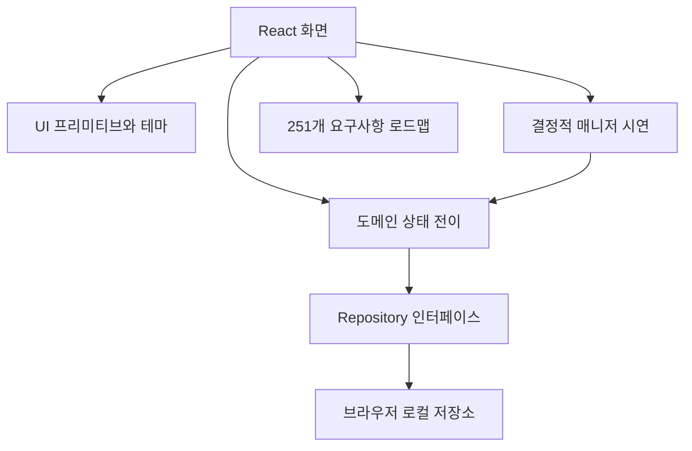

# 아키텍처

## 후속 서버 수직 연결

`server/runtime/`는 실제 OIDC 세션/CSRF와 PostgreSQL 정본을 사용하는 별도 실행 경로다. 기본 웹 진입점은 해당 서버 API를 호출하고, 기존 브라우저 데모는 `/?demo=1`로 분리한다. REST와 쿠키 인증 MCP는 같은 `RuntimeService`/`KnowledgeService`를 사용한다. 모델 호출은 DB 잠금 밖에서 수행하고, 전체 입력 계보·원본/페이지 권한·기준 버전을 재검사한다. 아래 기존 로컬 데모 설명은 이 서버 기능 전체를 설명하는 것이 아니다.

[실행 구성과 제한](OPERATIONAL_SETUP.md), [실제 시험/남은 범위](AGENT_HANDOFF.md)를 따른다. 동시접속 10명 이하를 초기 목표로 하고 K8s 앱1/DB1, 로컬 kind를 제공하지만 무인 worker·전체 편집/협업·서비스 주체 MCP·개인 커넥터 통합·실제 사내 운영 인수는 아직 미완료다. 공통 서버 정본 방향을 구현한 것이 ADR004의 모든 범위/제품 승인을 자동 완료한 것은 아니다.

## 소유권·공간 역할 확장 제안 (2026-10-30)

[권한 모델](ACCESS_CONTROL.md)과 [ADR 005](adr/005-github-style-access-control.md)는 로컬 저장 위치와 개인/팀 소유권, Private/Team/Company 공개 범위, 공간별 Read/Triage/Write/Maintain/Admin을 분리하는 **미구현 제안**이다. 현행 `workspaces`를 지식 공간으로 유지하고 namespace·팀/그룹·grant·자료 제한을 추가하는 이관 경계를 정의한다. 서버의 현재 3역할·OIDC·전체 입력 계보 검사는 실제 구현이며, 새 역할·토큰·개인 커넥터 통합이 완료된 것으로 해석하지 않는다. 과거 데모 설명보다 최신 실행 범위는 위 후속 서버 경로를 우선한다.

## 기존 로컬 데모 구현

React와 TypeScript, Vite로 만든 정적 앱이다. 데이터는 합성 fixture에서 시작하며 같은 origin의 localStorage에 저장된다. Node 로컬 실행기는 정적 파일과 선택적 /api/model 중계를 제공한다. 제품용 DB·인증 세션·서버 ACL은 없다.

`domain/types.ts`는 개체와 액션, `engine.ts`는 발행·충돌·복원·범위 규칙, `seed.ts`는 합성 데이터다. `adapters/repository.ts`가 저장소 경계다. 화면 간 탐색은 정적 서버에서도 재작성 규칙 없이 작동하는 hash URL을 사용한다. 안전한 Markdown 출력에 marked와 DOMPurify를 사용한다.

## 지식 누적 엔진

src/domain/wiki.ts는 기존 도메인과 분리된 편입·질문·점검 상태 전이다. State.knowledge가 없던 이전 데이터도 빈 상태로 읽는다. features/KnowledgeWorkbench.tsx는 엔진 선택·원본 등록·변경 집합·질문·Lint·인덱스를 제공한다. adapters/model.ts는 실제 모델 요청과 응답 형식을 검사한다. Node scripts/model-api.mjs는 서버 환경의 모델 URL·키와 wiki/SCHEMA.md를 사용한다.

현재 변경 집합은 원본 스냅샷과 기준 버전, 승인한 전체 내용에 연결된다. 발행은 단일 로컬 상태 교체로 모든 페이지를 함께 반영한다. 질문의 고정 버전은 /snapshot/{id}/{version} hash 화면으로 열 수 있다. 현재 권한은 데모 역할 필터이며 실제 보안 경계가 아니다.

## 현재 데이터 개체

문서·버전·산출물·변경안·실행 기록·활동 기록·공유 링크·일정 설정을 분리한다. 버전은 원본 ID를 보존한다. 변경안은 기준 문서 버전과 새 근거를 보존하며 승인 후 발행 때 기준 버전을 다시 검사한다. 복원은 공개 범위를 바꾸지 않고 새 버전을 추가한다.

서버 간 일관성·다중 탭 동시성·DB에서의 원자 발행은 구현하지 않았다. 기존 변경안은 단일 문서 단위이며 새 지식 컴파일은 여러 페이지의 로컬 일괄 발행을 제공한다. REV-006의 DB 트랜잭션·다중 사용자·장애 복구 인수 조건은 남아 있다.

## 서버로 전환할 경계

별도 개발 경로로 `scripts/wiki-connector/`에 로컬 JSON 작업본·개인 공간 동기화·STDIO MCP·명시적 단일 페이지 공유 제안을 제공한다. 상대는 loopback 합성 파일 서비스이며 기존 React 상태와 분리돼 있다. 운영 저장을 파일로 전환한다는 결정이 아니고 아래 PostgreSQL·서버 ACL·의존 변경 집합 계약은 그대로 유지한다. [실제 범위와 한계](LOCAL_WIKI.md)를 따른다. 호스트 연결 중에만 실행하고 종료 후에는 동기화하지 않는다. 로컬 daemon·OS 서비스·시작 프로그램·예약 작업에 의한 상시 실행은 제품 범위에서 제외하며 향후 과제가 아니다. 미전송 변경은 다음 연결 때 재개한다. 서버 측 지속 작업·스케줄러는 이 로컬 실행 정책과 별개다.

향후 통합은 **공통 서버 지식 서비스의 발행본과 원본/권한을 정본으로 삼고 로컬 커넥터는 허용된 개인 작업본·제안 어댑터로 유지**하는 방향을 검토한다. 현재 복수 페이지 웹 컴파일 경로와 단일 페이지 로컬 공유 제안은 연결되지 않았다. [통합 계획·수용 시나리오](KNOWLEDGE_INTEGRATION.md) 및 아직 **제안 상태**인 [ADR 004](adr/004-unified-knowledge-service.md)를 참고한다. 이것은 채택·구현 완료 선언이 아니다.

1. Repository를 비동기 서버 클라이언트로 교체하고 인증된 사용자·그룹을 서버에서 해석한다. UI 역할 선택을 제거한다.
2. 도메인 불변식을 서버 서비스 계층과 트랜잭션에서 강제한다. 클라이언트 엔진은 미리보기 역할만 갖는다.
3. 본문·버전·근거·발행 집합을 PostgreSQL, 원본·첨부를 회사 승인 오브젝트 저장소에 저장한다.
4. 수락 기록·후속 이벤트·재시도·실행 임대로 작업자를 분리한다. 앱 프로세스 타이머를 무인 스케줄러로 사용하지 않는다.
5. 매니저를 모델 게이트웨이 어댑터로 연결한다. 구조화된 변경안을 생성하고 근거·권한·예산 검증 후 검토함으로 보낸다.
6. 검색·임베딩은 재구축 가능한 파생 데이터다. 후보 검색 전후와 답변 출력에서 현재 권한을 확인한다.

프레임워크를 먼저 확정하지 않는다. FastAPI 등 사내 표준 백엔드로 구현해도 클라이언트 DTO와 서버 권한·버전 계약이 유지되면 된다. UI 서버 경계를 명확히 해서 기존 admission-gate의 공통 모듈을 재사용한다.

## 1차 K8s 배포 목표(아직 미구현)

서버 전환의 첫 단위로 `server/`에 PostgreSQL 정본/승인·원자 발행·감사·사용 이벤트 서비스와 인증 콜백 주입형 사용량 GET 핸들러를 추가했다. 기본 UI 업무는 계속 localStorage이며 사용량 화면만 같은 origin의 서버 집계를 요청한다. 정적 데모는 사용량 미연결을 표시한다. 실제 SSO/업무 API·MCP·지속 작업·전체 UI 서버 전환은 아직 없다. [서버 기반 구현 경계와 실제 검증](SERVER_FOUNDATION.md)을 따른다.

동일 클러스터 내 `agent-knowledge-hub-stg` 및 `agent-knowledge-hub-prod` 네임스페이스마다 앱 1개와 PostgreSQL 인스턴스 1개를 독립 운영한다. 단일 replica와 DB는 초기 운영 복잡도를 줄이는 선택이지 가용성·3만 사용자 처리량의 검증이 아니다. 실사용 전 서버 저장소·권한·백업·복원·관측 등 최소 게이트를 충족해야 한다. 배포 계약은 [K8S_RELEASE.md](K8S_RELEASE.md), 확장 조건은 [SCALING_PLAN.md](SCALING_PLAN.md), 결정 기록은 [ADR 003](adr/003-single-cluster-initial-release.md)을 참조한다.
