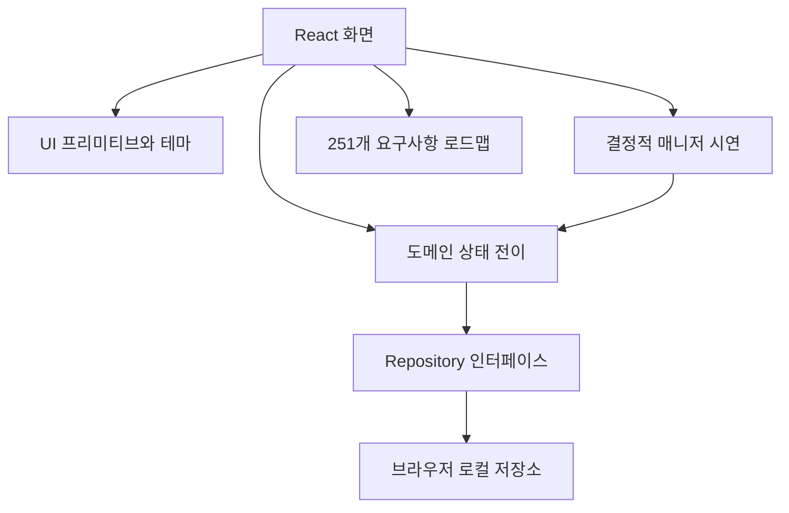

# 아키텍처

## 현재 구현

React와 TypeScript, Vite로 만든 정적 앱이다. 데이터는 합성 fixture에서 시작하며 같은 origin의 localStorage에 저장된다. Node 로컬 실행기는 정적 파일과 선택적 /api/model 중계를 제공한다. 제품용 DB·인증 세션·서버 ACL은 없다.

`domain/types.ts`는 개체와 액션, `engine.ts`는 발행·충돌·복원·범위 규칙, `seed.ts`는 합성 데이터다. `adapters/repository.ts`가 저장소 경계다. 화면 간 탐색은 정적 서버에서도 재작성 규칙 없이 작동하는 hash URL을 사용한다. 안전한 Markdown 출력에 marked와 DOMPurify를 사용한다.

## 지식 누적 엔진

src/domain/wiki.ts는 기존 도메인과 분리된 편입·질문·점검 상태 전이다. State.knowledge가 없던 이전 데이터도 빈 상태로 읽는다. features/KnowledgeWorkbench.tsx는 엔진 선택·원본 등록·변경 집합·질문·Lint·인덱스를 제공한다. adapters/model.ts는 실제 모델 요청과 응답 형식을 검사한다. Node scripts/model-api.mjs는 서버 환경의 모델 URL·키와 wiki/SCHEMA.md를 사용한다.

현재 변경 집합은 원본 스냅샷과 기준 버전, 승인한 전체 내용에 연결된다. 발행은 단일 로컬 상태 교체로 모든 페이지를 함께 반영한다. 질문의 고정 버전은 /snapshot/{id}/{version} hash 화면으로 열 수 있다. 현재 권한은 데모 역할 필터이며 실제 보안 경계가 아니다.

## 현재 데이터 개체

문서·버전·산출물·변경안·실행 기록·활동 기록·공유 링크·일정 설정을 분리한다. 버전은 원본 ID를 보존한다. 변경안은 기준 문서 버전과 새 근거를 보존하며 승인 후 발행 때 기준 버전을 다시 검사한다. 복원은 공개 범위를 바꾸지 않고 새 버전을 추가한다.

서버 간 일관성·다중 탭 동시성·DB에서의 원자 발행은 구현하지 않았다. 기존 변경안은 단일 문서 단위이며 새 지식 컴파일은 여러 페이지의 로컬 일괄 발행을 제공한다. REV-006의 DB 트랜잭션·다중 사용자·장애 복구 인수 조건은 남아 있다.

## 서버로 전환할 경계

1. Repository를 비동기 서버 클라이언트로 교체하고 인증된 사용자·그룹을 서버에서 해석한다. UI 역할 선택을 제거한다.
2. 도메인 불변식을 서버 서비스 계층과 트랜잭션에서 강제한다. 클라이언트 엔진은 미리보기 역할만 갖는다.
3. 본문·버전·근거·발행 집합을 PostgreSQL, 원본·첨부를 회사 승인 오브젝트 저장소에 저장한다.
4. 수락 기록·후속 이벤트·재시도·실행 임대로 작업자를 분리한다. 앱 프로세스 타이머를 무인 스케줄러로 사용하지 않는다.
5. 매니저를 모델 게이트웨이 어댑터로 연결한다. 구조화된 변경안을 생성하고 근거·권한·예산 검증 후 검토함으로 보낸다.
6. 검색·임베딩은 재구축 가능한 파생 데이터다. 후보 검색 전후와 답변 출력에서 현재 권한을 확인한다.

프레임워크를 먼저 확정하지 않는다. FastAPI 등 사내 표준 백엔드로 구현해도 클라이언트 DTO와 서버 권한·버전 계약이 유지되면 된다. UI 서버 경계를 명확히 해서 기존 admission-gate의 공통 모듈을 재사용한다.
