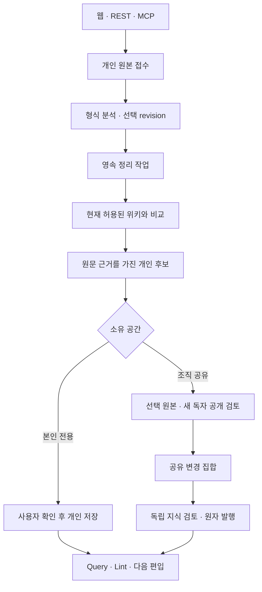

# 웹 데이터 입력 → 자동 정리 → 위키 반영

> **상태: 설계와 실제 구현 포함 (2026-10-30).** 실행/API·지원 형식·설정·검증·남은 범위의 기준은 [IMPLEMENTATION_GUIDE.md](IMPLEMENTATION_GUIDE.md)다. [ADR 006](adr/006-web-first-data-ingestion.md)은 웹/서버 선택 이유, [대화 계약](CONVERSATION_IMPORT.md)은 의미·근거 규칙을 설명한다. 이번 구현은 기존 251개 요구사항 전체 또는 운영 인수 완료가 아니다.

## 1. 웹을 기본으로, 서버가 정리한다

메신저 1주일치 대화·문서·업무 메모는 웹의 붙여넣기/파일 선택/드래그앤드롭으로 충분하다. 파일을 선택하면 서버가 형식을 분석하고, 사용자가 범위를 확인하면 기존 위키와 비교해 연결된 변경 후보를 만든다. 앱 설치·MCP·페이지 ID 입력을 요구하지 않는다.

| 상황 | 선택 |
| --- | --- |
| 사용자가 선택한 파일/텍스트 | 웹 → 공통 편입 서비스 |
| 탭 종료 이후의 긴 처리/복구 | PostgreSQL 영속 작업 + 서버 worker |
| 에이전트 입력 | 실제 REST/MCP → 같은 서비스 |
| 반복 메신저 API 수집 | 후속 공식 어댑터. 현재 파일 입력과 구분 |
| PC 안에서만 가능한 자료/OS 기능 | 필요가 확인된 뒤 연결 중 로컬 브리지/별도 ADR. 설치형 앱도 원본 권한을 우회하지 못함 |

브라우저는 선택 파일을 읽을 수 있지만 다른 앱의 대화 DB를 임의로 읽는다고 가정하지 않는다. PWA/Service Worker 수명을 지속 작업 보장으로 쓰지 않는다. 로컬 커넥터의 상시 daemon·OS 서비스·시작 프로그램·예약 동기화 제외 결정은 유지한다.

## 2. 입력에서 정본까지

원본·파싱 레코드·모델 후보·발행본은 다른 상태다. 팀 자동 정리의 종료는 개인 `review_ready`이며 공유 원본 승인과 지식 발행을 생략하지 않는다. 개인 저장은 본인 Owner의 명시적 행동으로 본인만 읽는 공간에 반영한다. 현재 데이터 DTO의 team 분류 문자열과 실제 개인 공간의 소유/ACL은 별도 축이다.

## 3. 화면과 API

웹의 **자료 넣기 · 자동 정리**는 개인 수집함, 전송/분석 상태, 형식·인코딩·시간대·기간·프로젝트·CSV 매핑, 발언별 제외, 누락 안내, 작업·후보·근거, 개인 저장/공개 검토를 제공한다. 경고 확인은 의미 검증 완료가 아니다. 기존 **변경 검토** 화면이 공유 지식 승인·발행을 담당한다.

| API | 실제 동작 |
| --- | --- |
| `GET /api/v1/imports/config` | 조각 크기·담당 검토자·개인 공간 여부 |
| `POST /api/v1/imports` | 본인 원본 manifest 접수, 멱등 키 |
| `POST /imports/:id/files/:fileId/parts/:part` | 256 KiB 이내 base64 JSON + SHA256. 동일 조각 재전송 가능 |
| `POST /imports/:id/finalize` | 모든 바이트/해시 확인 후 서버 분석 접수 |
| `GET /imports/:id?offset=0` | 본인 레코드 미리보기 50개 단위/상태 |
| `PATCH /imports/:id/selection` | If-Match revision으로 선택 변경. 의미 변경은 재분석 필요 |
| `POST /imports/:id/runs` | model/offline 정리 접수, 멱등 키 |
| `GET /import-runs/:id` | 현재 권한으로 결과 재조회 |
| `POST /import-runs/:id/cancel`, `resume` | 취소 요청/현재 권한으로 재개 |
| `POST /import-runs/:id/save-personal` | 검증된 개인 Owner의 본인 전용 위키 저장 |
| `POST /import-runs/:id/disclosure` | 선택 원본/후보/독자/독립 공개 검토자를 고정해 제출 |
| `GET /import-disclosures` | 지정 공개 검토자의 제출본 큐 |
| `POST /import-runs/:id/approve-disclosure` | 원본 공개 승인 + 변경 집합 생성 |
| `DELETE /imports/:id` | 개인 원본 삭제 + 해당 공유 원본 철회 |

표의 축약 경로에도 `/api/v1`가 붙는다. 인증 신원은 OIDC 세션에서 얻고 클라이언트 principal/role은 받지 않는다. 쓰기는 Origin/CSRF 검사를 통과해야 한다. MCP의 7개 `knowledge_import_*` 도구가 동일 선택/파싱/실행 계약을 호출하며 공개 승인·발행 도구는 제공하지 않는다.

## 4. 정규화와 지식 갱신

- TXT/Markdown·지원 메신저 텍스트 패턴·공통 JSON/JSONL·CSV·Slack JSON/ZIP을 제한된 크기로 읽는다. 지원하지 않는 형식/인코딩은 실패 또는 사용자 선택을 요구한다. PDF/OCR·오피스/바이너리 첨부·실시간 메신저 연동은 후속이다.
- 원본 파일/ZIP entry/행·JSON 위치/SHA256, 화자 표시명(미인증), 원문 시각·확인된 시간대, 채널/스레드/문자열 ID·수정/삭제 사건을 보존한다. 알 수 없는 날짜·신원·원본 ACL을 생성하지 않는다.
- 같은 ID+내용의 입력 내 중복만 병합한다. namespace가 없으면 파일 해시를 사용해 다른 export의 신원을 추측하지 않는다. 겹치는 export를 자동으로 최신 정본/독립 증거 여러 개로 확정하지 않는다. 관측 기록은 남지만 전역 의미 중복 판단의 정확도를 측정한 것은 아니다.
- 명시 tombstone과 같은 사용자/namespace의 공유 원본 계보가 연결되면 그 원본을 철회한다. 다음 export의 부재는 삭제로 추정하지 않는다. 파일 입력으로 외부 서비스의 현재 ACL·모든 편집/삭제를 추적할 수 없다.
- 모델은 현재 읽을 수 있는 기존 페이지와 선택 레코드만 받는다. 원문은 실행 명령이 아닌 비신뢰 자료다. 공급자/모델 전송은 배포의 명시 설정을 따른다.
- 최대 50개 발언/100k bytes 청크별 후보 후 최종 재조정으로 조건·예외·다른 날의 반증을 비교한다. 기존 페이지의 전체 본문 변경, 새 주제, 관련 링크를 제안한다. 청크별 모든 선택 ID를 근거/명시 제외로 회계하고, 최종 통합은 후보 ID 전체를 중복/누락 없이 배정하며 검증된 인용을 서버가 이어 붙인다. 인용 문자열·대상 페이지를 검사한다. 한도 초과·모델 잘림·근거 불일치는 실패이며 일부를 전체 완료로 표시하지 않는다.
- `statement / proposal / decision_report / question / commitment / completion_claim / observation`을 구분한다. 결정 진술은 공식 권한 증거, 완료 주장은 실행 로그가 아니다. 의미 정확도와 후속 업무 효과는 별도 평가 대상이다.

## 5. 내구성·권한·철회

초기 App1/DB1의 원본 조각은 PostgreSQL bytea로 보관해 원본/manifest/작업을 같은 백업 경계에 둔다. App에 임시 디스크만 남기거나 아직 없는 객체 저장소를 필수 구성으로 가정하지 않는다. 파일/사용자/공간/큐/청크 상한은 구현 가이드를 따른다.

`uploading → queued/running(preflight) → parsed → queued/running(model) → review_ready/no_changes → proposed`가 기본 경로다. `failed / cancelled / authorization_required`는 성공과 구별한다. 선택 의미 변경은 revision을 올리고 분석/확인을 무효화한다.

worker는 DB에서 SKIP LOCKED로 claim하고 120초 lease/20초 heartbeat·세대 fencing을 사용한다. 원본 분석은 별도 자식 프로세스에서 256 MiB V8 heap/30초 제한으로 수행한다. checkpoint는 파싱·선택·실행/모델 호출 시도 상태이며 개별 청크 모델 출력 재사용이나 외부 호출 exactly-once 과금을 보장하지 않는다.

작업 위임은 originating session·주체·공간·role·선택 revision·정책·모델 설정·최대 1시간에 고정한다. 탭 닫기는 세션/작업 철회가 아니지만 자연 세션 만료·명시 로그아웃·IdP 실패·역할 회수는 다음 단계/결과 저장을 막는다. 모델 응답 후에도 원본/전체 입력 ACL·기준/정책을 재검사한다. 취소 요청과 취소 완료는 구분하며 이미 전송한 입력의 공급자 측 회수를 약속하지 않는다.

개인 원본은 업로더만 읽는다. 공유 제출은 선택 스냅샷만 지정 검토자에게 전달한다. 외부 ACL을 모르는 수동 export를 자동 공유하지 않으며 `IMPORT_DISCLOSURE_REVIEWERS`의 별도 공개 정책 담당자가 현재 자격과 입력·새 독자를 확인해야 한다. 원본 공개 후에도 원문이 허용한 독자의 교집합을 지키고 별도 독립 지식 검토/현재 승인 해시로 발행한다. Owner/Admin도 이 상한을 넘지 못한다.

원본 삭제/철회·접근 회수 후에는 결과/현재·과거 페이지/답변/발행 재시도에 현재 ACL을 적용한다. 이미 반출한 평문·과거 DB 백업·종속 버전의 물리 바이트 전역 소거는 별도 보존 정책이다. 실제 원본 서비스와 지속 연결되지 않은 파일의 실시간 철회는 추정하지 않는다.

## 6. 수용 시나리오와 증거 수준

DI-01~24는 제품 인수 계약을 유지한다. 순수 파서/모델 계약·DB·실제 HTTP/SDK MCP·브라우저 fixture 회귀는 해당 경로의 구현 증거이며 모든 시나리오의 운영/의미 품질 통과가 아니다. 기존 251개 요구사항·35개 인수 시나리오의 내용/상태/수는 바꾸지 않는다.

| ID | 입력/상황 | 기대 검사 | 기존 관련 기준 |
| --- | --- | --- | --- |
| DI-01 | MCP 없는 사용자가 대화 파일/텍스트 입력 | 웹만으로 선택·개인 수집·preflight·정리 제안·검토 진입 가능 | COL-002/013, UX-002 |
| DI-02 | 업로드 중 종료/재선택, finalize 뒤 탭 종료 | 미전송 자료 처리 안 함, 동일 파일 검증 후 재개, 서버 수락 후 작업 유지 | JOB-001/005 |
| DI-03 | 서버/worker 재시작·lease 경합·늦은 응답 | checkpoint 재개, fencing으로 오래된 결과 차단, 변경 집합 중복 없음 | JOB-001~007 |
| DI-04 | 브라우저 미리보기와 서버 검사 불일치/낡은 selection | 서버 결과 우선, revision 충돌 거부, 새 입력으로 재검사 | COL-012, JOB-006 |
| DI-05 | 한글/이모지·멀티라인·JSON/TXT/CSV 매핑·잘못된 인코딩 | 원문 anchor/텍스트 보존, 애매한 형식은 보완, 조용한 유실 없음 | COL-001/004/012 |
| DI-06 | ZIP 폭탄·경로 탈출·실행파일·HTML·원문 링크 | 상한/격리/정제, 자동 원격 호출/실행 없음 | SEC-005/006, JOB-012 |
| DI-07 | 같은 파일 재전송, 겹치는 주간 export, 실제 반복 발언 | 검증 ID/버전 중복만 병합, 독립 발언은 보존, 타 공간 파일 존재 비노출 | COL-009, ACL-008 |
| DI-08 | 메시지 수정/삭제 이벤트, export에서 메시지가 사라짐 | 수정/명시 삭제의 새 revision/철회 전파, 단순 부재를 삭제로 추정하지 않음 | COL-009/010, LIF-007 |
| DI-09 | 주말 답글과 기간 밖 부모, 업로드 밖 첨부·스레드 | 문맥/자료 누락 표시, 연결 지어내거나 전체 수집 완료 표시 금지 | KNO-002/005, COL-012 |
| DI-10 | 동일 표시명/대화방 이름, 타임존/상대 날짜 불명 | 신원/대화 ID를 자동 합치지 않음, 모르는 날짜/검증 시각을 생성하지 않음 | COL-008, KNO-013 |
| DI-11 | 제안 → 결정 진술 → 완료 주장 → 반증의 1주 대화 | 상태/환경/근거 구별, 완료 주장을 실행 검증으로 승격하지 않음 | COL-011, KNO-004~009 |
| DI-12 | 이미 있는 위키와 같은 자료 또는 새 예외/반증 | no_changes 또는 기존 페이지/관계 갱신 제안. 요약 파일 추가만으로 통과 불가 | KNO-001/006/010, CORE-003 |
| DI-13 | 청크 경계의 부정/예외·겹침, 문맥/비용 한도 초과 | 교차 구간 재검사, 중복 근거 방지, coverage/미처리 범위 공개 | MGR-012, CORE-008 |
| DI-14 | 모델 미연결·잘림·스키마/인용 오류·재시도 중 과금 | 거짓 성공/묵시적 offline 대체 없음, 시도/실측과 오류 구분 | CORE-008, JOB-004 |
| DI-15 | ACL 없는 수동 export, 대화 참여자/업로더가 다름 | 허용된 개인 제한 또는 저장 거부, 팀 독자/저자 자동 부여 없음 | ACL-004~006, COL-008 |
| DI-16 | 제한 원본·숨은 모델 입력·팀 검토자 무권한 | 후보/원문/diff/답변에도 현재 교집합, 공유/검토 차단 | ACL-005/007/014, REV-003 |
| DI-17 | 전송 금지 등급·제외 구간·본문의 권한/도구 명령 | 지정 모델/OCR/임베딩 밖 전송 차단, 인젝션으로 정책 변경 없음 | SEC-002/004/011 |
| DI-18 | 로그아웃·원본/역할 철회·IdP 장애·실행 grant 만료 | 다음 단계/응답/커밋 차단, 권한 재확인/새 grant 전 재개 불가 | ACL-007/012/013, JOB-006 |
| DI-19 | 취소 요청과 모델/단계 커밋 경쟁 | 요청/완료 구분, 이후 변경 집합/발행 없음, 이미 전송된 입력 회수 보장 없음 | JOB-008/012 |
| DI-20 | 전체 자동 정리 후 자기 승인/자동 팀 발행 시도 | review_ready까지만, 현재 지정 독립 사람 검토/발행 필요 | MGR-009, REV-003~006 |
| DI-21 | blob 업로드 후 DB 실패·체크섬 불일치·백업 복구 | ready 아닌 원본 처리 안 함, 안전한 staging 정리·일관 복구·삭제 재적용 | COL-010, OPS-008/009, LIF-005/006 |
| DI-22 | 대량 import와 읽기/질문 동시 실행, 페이지 한도 초과 | 자원/큐/예산 분리·역압, 의존 집합 부분 발행 없음 | JOB-009/010, REV-006, MGR-012 |
| DI-23 | 동일 입력을 웹/API/MCP로 제출, source/parser 선택 변경 | 공통 서비스·권한·멱등 결과, 버전 변경은 새 run/재검토 | COL-001/009, INT-001/002 |
| DI-24 | 원본 삭제/정정·반려/사람 수정 후 다시 정리 | 원본/파생 계보 영향 전파, 삭제본/반려 변경을 무단 재생성하지 않음 | LIF-007, KNO-014, CORE-007 |

현재 자동 회귀의 직접 근거는 `server/imports/{parser,organizer,service,http}.test.ts`, `server/access.test.ts`, 기존 runtime/publication/provenance 회귀다. 브라우저 합성 대화의 원본 공개→지식 검토→발행 증거는 `docs/pr-assets/ingestion`에 둔다. DI-11~14의 실제 모델 의미 정확도/비용, DI-21 백업·복원, DI-22 운영 부하, 모든 사내 원본 어댑터/SSO 수용은 별도 실행이 필요하다. 토큰/금액을 실제 수집하지 않은 작업에 추정 실측값을 표시하지 않는다.

## 7. 설계 근거

2026-10-30에 확인한 1차 자료:

- [MDN File API](https://developer.mozilla.org/en-US/docs/Web/API/File_API/Using_files_from_web_applications): 사용자가 선택한 파일을 웹에서 읽고 전송하는 경로.
- [MDN Service Worker](https://developer.mozilla.org/en-US/docs/Web/API/Service_Worker_API): 브라우저 worker 수명은 영속 서버 큐의 대체가 아님.
- [OWASP File Upload](https://cheatsheetseries.owasp.org/cheatsheets/File_Upload_Cheat_Sheet.html): 형식·경로·크기·저장/권한·처리 격리.
- [Slack export 형식](https://slack.com/help/articles/220556107-How-to-read-Slack-data-exports), [스레드 API](https://docs.slack.dev/messaging/retrieving-messages): 파일/메시지/답글/첨부 링크의 구별.
- [yauzl](https://github.com/thejoshwolfe/yauzl), [csv-parse](https://csv.js.org/parse/): ZIP/CSV 경계 처리. 코드가 별도로 압축 한도와 CRC·경로·중복 컬럼을 검사한다.
