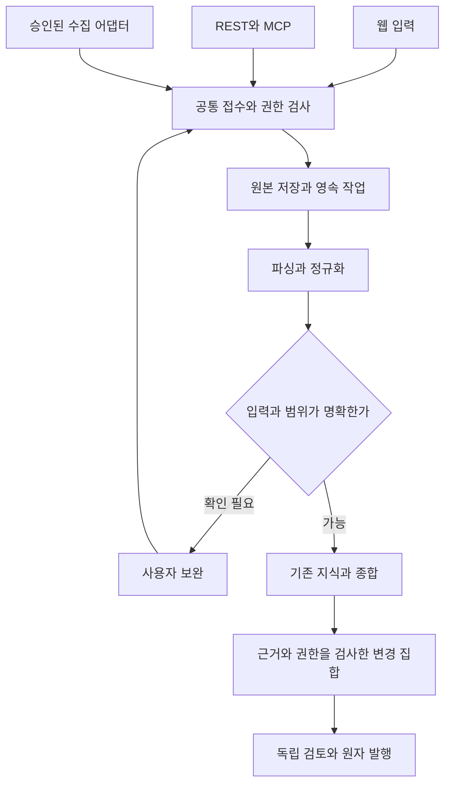

# 웹 데이터 입력 → 자동 정리 → 위키 변경 제안

> **상태: 후속 설계 제안 / 미구현 / DI-01~24 미실행 (2026-10-30).** 기준은 `main@ec148ef9`와 권한 설계 PR #11의 `1043da9c`다. [ADR 006](adr/006-web-first-data-ingestion.md)에 결정 이유를, [대화 기록 편입](CONVERSATION_IMPORT.md)에 메신저 1주일 예시·파서 계약을 둔다. 이 문서는 파일 업로드·지속 작업·새 UI를 구현했다는 보고서가 아니다.

## 1. 선택: 웹을 기본으로, 서버가 자동 정리를 수행한다

사용자가 파일을 선택하거나 텍스트를 붙여넣으면 **자료 인식·정규화·중복 검사·지식 추출·기존 위키와 비교·변경 제안**을 서버가 자동 수행한다. 처음부터 전용 데스크톱 앱 설치를 요구하지 않는다. MCP는 같은 기능을 호출하는 입력 채널 중 하나다.

| 사용 상황 | 기본 경로 | 경계 |
| --- | --- | --- |
| 대화 내보내기 파일, 회의록, 업무 메모를 선택해 등록 | 웹의 붙여넣기·파일 선택·드래그앤드롭 | 사용자가 선택한 자료만 전송 |
| 수십 분 걸리는 파일 정리, 탭 종료/다른 기기에서 상태 확인 | 서버의 영속 편입 작업 + 작업함 | 업로드 완료·서버 수락 뒤에만 브라우저와 독립적으로 진행 |
| 에이전트가 만든 산출물 등록 | REST/MCP → 같은 접수/편입 서비스 | 도구별로 별도 종합·발행 엔진을 만들지 않음 |
| 승인된 메신저 API로 반복 수집 | 서버 수집 어댑터 → 같은 접수 서비스 | 해당 서비스의 인증·허용 채널·ACL·지원 버전 검증 필요 |
| 자료를 서버로 보내기 전 PC 안에서만 전처리해야 함 | 연결 중 실행하는 선택적 로컬 브리지 검토 | 기존 로컬 수명주기·허용 경로·반출 정책 유지. 완전 로컬 LLM은 별도 제품 범위 결정 |
| 다른 앱 내부 데이터·OS 기능 접근이 꼭 필요함 | 공식 API/내보내기 가능성을 먼저 확인, 필요 시 별도 클라이언트 ADR | 설치형 앱도 메신저 권한·자료 반출 정책을 우회하지 못함 |

브라우저 File API로 사용자가 선택한 파일을 읽고 업로드할 수 있다. 브라우저가 다른 앱의 대화 DB나 임의 파일 경로를 자동 읽는다고 가정하지 않는다. Web Worker는 입력 미리보기/해시 계산의 UI 멈춤을 줄이는 수단이며 영속 서버 작업자의 대체가 아니다. PWA 설치·Service Worker 생존에 장시간 편입을 의존하지 않는다. 근거 링크는 §12에 있다.

**로컬 커넥터 상시 daemon·OS 서비스·시작 프로그램·예약 동기화 제외 결정은 유지한다.** 반복 서버 수집과 서버 worker는 이 로컬 제외 범위와 별개다. 데스크톱 앱이 없어도 승인된 사내 웹/API/모델/저장소 안에서 동작하도록 설계한다.

## 2. 공통 편입 서비스

핵심 서비스의 책임은 `ImportService`(접수·원본·선택 범위), `ParserAdapter`(형식별 근거 위치 보존), `IngestionOrchestrator`(영속 단계·예산), 기존 지식 서비스(근거·종합·검토·발행)로 구분한다. 이름은 제안 계약이며 새 코드가 존재한다는 뜻은 아니다. 전용 챗봇/임포터가 공유 페이지를 직접 쓰는 우회 경로를 만들지 않는다.

**자동 정리의 기본 종료는 `review_ready` 또는 `no_changes`다. 공유 위키는 승인·발행을 거쳐 반영한다.** 자동 추출·개인 정리 결과를 자동 팀 공개나 공식 기준 채택으로 표시하지 않는다. 초기 입력의 의미 있는 변경은 모두 검토 대상으로 하며 기존 MGR-009의 좁은 자동 반영 정책과 혼동하지 않는다.

## 3. 사용자 흐름과 화면

일반 사용자는 메신저에서 허용된 범위를 내보내고 웹의 **자료 넣기**에서 파일을 선택하면 된다. 앱 설치·CLI·MCP 설정·페이지 ID 입력을 요구하지 않는다. 기본은 개인 수집함, 자동 형식 감지와 관련 공간 추천이다. 대상 공간과 자료 등급/공유 가능 범위는 사용자 권한 안에서 확인한다.

| 단계 | 화면과 동작 | 서버/실패 계약 |
| --- | --- | --- |
| 1. 자료 선택 | `텍스트 붙여넣기 / 파일 올리기`, 선택 파일·용량 표시 | 브라우저 미리보기 전에 업로드됐다고 표시하지 않음. 미선택 파일/대화 자동 수집 금지 |
| 2. 입력 확인 | 형식·기간·대화방/문서·참여자 표시명·메시지 수, 제외 범위·민감 항목·현재 독자 표시 | 브라우저의 전처리는 안내용. 서버가 다시 검사하며 파싱이 애매하면 이 화면에서 보완 |
| 3. 정리 시작 | `선택 자료 정리` 한 번으로 자동 파이프라인 수락. 대상은 기본 개인, 팀 선택 시 현재 Write 이상 검사 | 파일/대화/기간 선택과 전송·모델 목적지 정책을 고정. 변경한 선택은 새 입력 revision |
| 4. 진행 확인 | 업로드율과 정리 단계를 별도 표시, 처리/제외/중복/실패 수·예산·중단/재시도 | 모델 호출 수로 의미 진행률을 꾸미지 않음. 서버 수락 후 작업 링크로 복귀 가능 |
| 5. 정리 결과 | 주제·결정/제안·미해결·상충·기존 페이지 변경/신규 후보. 각 주장 옆 원문 근거 | 미확인·실패·제외를 성공으로 숨기지 않음. 원본은 일반 검색/타인에게 자동 공개하지 않음 |
| 6. 검토와 발행 | 현재/제안 diff, 근거 발언 앞뒤 맥락, 독자 변화·검토자·유효 승인 표시 | 기존 changeset 서비스로 이동. 의존 변경 일부만 골라 의미를 바꾸면 새 집합으로 재검증 |

작업함은 개인 자료/실행 상태와 팀 검토함을 구별한다. 데스크톱은 좌측 원문/기간·중앙 추출 후보·우측 관련 위키 diff로 탐색하고, 좁은 화면은 `입력 / 후보 / 변경 / 근거` 탭으로 전환한다. 실제 UI 컴포넌트는 기존 토큰·프리미티브를 재사용하며 이 레이아웃이 구현됐다고 표시하지 않는다.

자동 감지가 충분하면 형식/타임존/컬럼을 매번 묻지 않는다. 애매한 날짜, 식별자 충돌, 새 독자로의 공개, 포함하지 못한 문맥만 보완한다. 추출 후보 수정은 원본 수정이 아니며 검토 내용/해시를 갱신한다. 권한 회수 시 열린 원문·후보·diff·오류 상세를 함께 제거한다.

## 4. 입력 어댑터와 지원 선언

| 입력 | 첫 구현 목표 | 근거/호환 계약 |
| --- | --- | --- |
| 텍스트 붙여넣기, TXT/Markdown | 지원 | 원문/행 위치 보존. 대화 파싱에 실패해도 일반 문서로 처리할지 사용자가 선택 |
| 플랫폼 정의 JSON/JSONL | 지원 | 버전 있는 공통 문서/대화 레코드 스키마. 임의 JSON을 같은 스키마라고 가정하지 않음 |
| CSV | 사용자 컬럼 매핑으로 지원 | 본문·시간·화자·원본 ID·대화방 매핑과 인코딩 확인. 표 데이터는 의미를 추정해 대화로 만들지 않음 |
| 메신저별 TXT/JSON/ZIP | 어댑터별 검증 후 활성화 | 첫 구조화 예시는 Slack JSON export. 실제 형식/버전 fixture를 통과한 어댑터만 지원 표시 |
| PDF/DOCX/HTML·이미지/OCR·오디오 | 추후 격리 변환 어댑터 | 현재 제품의 관련 필수 파일 처리 요구사항은 유지. 첫 대화 어댑터에 구현됐다고 표시하지 않음 |
| 메신저/문서 서비스 직접 연결 | 추후 승인된 서버 커넥터 | 내보내기 업로드와 OAuth/API 수집·삭제/ACL 동기화는 서로 다른 지원 단계 |

`ParserAdapter`는 형식 판별 점수/근거, 어댑터·버전, 레코드, 원문 anchor, 경고/제외/실패 목록, 완전성/기간 범위를 반환한다. 파일 확장자만으로 신뢰하지 않는다. 알 수 없는 형식·암호화 압축·첨부 바이너리는 명시적으로 거부/격리하고 JSON 전체를 모델에 던져 지원한 것으로 처리하지 않는다.

대화 내보내기의 파일 링크는 첨부 본문 확보를 뜻하지 않는다. 링크·HTML·메시지 안의 URL을 자동 다운로드/실행하지 않는다. 개인 토큰이나 서버 공용 키로 파일을 대신 가져오지 않으며 별도 승인된 수집/첨부 경로에서만 처리한다.

## 5. 자료 정리와 기존 지식 갱신

편입은 원본 → 정규화된 자료 단위 → 근거가 있는 후보 → 기존 지식과 비교 → 의존 변경 집합으로 진행한다. 정규화/분류만 한 결과와 실제 모델의 의미 종합을 구별한다. 모델 미연결·잘린 응답·스키마/인용 오류·불충분 문맥이면 종합 성공으로 기록하지 않는다.

추출 후보는 `진술/관찰`, `제안`, `결정 기록 후보`, `미해결 질문`, `작업 약속`, `실행 결과 주장`, `독립 실행 증거`를 구별한다. 형식/도구명은 진실·작성자 신원·공식성의 근거가 아니다. 화자가 “완료”라고 한 메시지는 실행 로그를 대체하지 않는다. 주제, 환경/버전, 유효 시점, 예외, 반증과 결정을 바꾼 이유를 보존한다.

기존 페이지는 현재 호출자/worker가 읽을 수 있는 발행본만 검색한다. 같은 주제 후보를 `신규 / 보완 / 중복 / 상충 / 편입 불필요`로 분류하고 근거를 제시한다. 일주일 요약 문서 한 개나 날짜별 게시물 일곱 개를 늘리는 것으로 끝내지 않고 기존 결론·조건·관계를 갱신하는 제안을 만든다. 실제 변화가 없으면 `no_changes`와 중복/제외 이유를 반환한다.

긴 입력은 대화 스레드/문서 절·시간/주제 경계를 보존하며 토큰 예산 안에서 나눈다. 이후 전체 후보를 다시 결합해 여러 구간의 정정·예외·상충을 검사한다. 요약의 요약만 남겨 근거 위치를 잃거나 같은 메시지를 여러 청크에서 독립 증거로 세지 않는다. 읽지 못한 구간/누락 첨부/기간 밖 문맥은 coverage manifest로 남긴다. 예산 초과로 일부만 읽었으면 전체 기간 정리 완료로 표시하지 않으며, 사용자가 축소 범위를 명시해야 그 범위의 결과를 확정할 수 있다.

주장마다 원본 버전/anchor와 정확한 인용을 연결하고 기존 모델 전체 입력 계보도 보존한다. 인용에서 빠진 제한 입력도 접근 상한에서 제거하지 않는다. 원본·어댑터·선택 범위·규칙·모델 입력이 바뀌면 새 revision/run으로 재처리한다. 사람의 이전 반려·수정·보호 이유를 후속 제안에서 존중한다.

## 6. 영속 상태·브라우저 종료·재시도

| 개체/단계 | 상태와 의미 |
| --- | --- |
| 업로드 세션 | `created / uploading / finalized / expired / cancelled`. finalized는 바이트·체크섬·메타데이터 수락이며 의미 정리 완료가 아님 |
| 편입 실행 | `queued / validating / parsing / sanitizing / compiling / validating_changes`로 단계와 체크포인트 보존 |
| 보완/권한 대기 | `needs_input / authorization_required / blocked`. 잘못된 인코딩·범위·승인된 모델 없음·권한 불명확을 구분 |
| 정리 종료 | `review_ready / no_changes`. 발행 상태는 별도 changeset의 검토/승인/발행 상태 |
| 오류/취소 | `failed / cancellation_requested / cancelled`. 취소 요청과 실제 부작용 중단을 구별하고 재시도 가능 여부 표시 |

요청은 수락 transaction 뒤 `202 + runId + statusUrl`을 반환한다. 브라우저가 열려 있어야 서버 모델 호출이 이어지는 설계를 피한다. 업로드 중 탭을 닫으면 미전송 바이트는 서버에 없으며, 파일을 재선택하고 같은 파일 해시/허용 범위를 확인해 전송을 재개한다. 파일 handle을 영구 사용할 수 있다고 약속하지 않는다. finalized 뒤 서버가 작업을 수락했다면 탭 종료/화면 새로고침은 실행 취소가 아니다.

worker는 브라우저 쿠키/토큰을 복사해 장기 보관하지 않는다. 서버가 `ExecutionGrant`로 원 요청자·입력/목적지·버전·작업·예산·만료를 고정하고 현재 신원/공간/원본 권한을 재확인한다. 탭 종료는 grant 철회가 아니지만, **명시적 로그아웃은 연결된 grant를 철회**하고 계정 중지·역할/원본 접근 회수·grant 만료/권한 확인 실패도 실행을 제한한다. 자격 회복 후 새 grant로 명시적 재개가 필요하다. 기존 동기 모델 요청의 로그아웃/세션 회수 시 결과 차단을 약화하지 않는다.

단계 claim은 DB lease·heartbeat·증가하는 fencing token으로 처리한다. 이전 worker가 늦게 돌아와도 새 lease의 결과를 덮어쓰지 못한다. 단계 결과는 `(runId, stage, inputFingerprint, attempt)`에 연결하고, 같은 입력/요청의 final changeset 생성은 유일 키로 중복을 막는다. 재시도 가능한 공급자 오류는 지연/상한을 두고, 파서/정책 오류는 사용자 보완이나 실패로 분리한다.

외부 모델 호출은 네트워크 오류/worker 장애에서 중복 과금될 수 있다. 공급자의 멱등 지원을 검증하기 전 외부 실행까지 exactly-once라고 주장하지 않는다. attempt별 실제 호출·토큰/비용·실패를 기록한다. 취소/철회 중 이미 전송한 입력의 완전 회수를 약속하지 않으며, 응답 저장·후속 단계·공유 변경안 커밋은 새 권한/취소/lease 검사로 차단한다. DB 트랜잭션 동안 모델 호출을 기다리지 않는다.

## 7. 소유권·공유·모델 전송

[ACCESS_CONTROL.md](ACCESS_CONTROL.md)의 5역할/자료 상한을 적용한다. 용어 대응상 Organization은 ADR 005의 팀 소유 namespace, GitHub Team은 접근 그룹이다. 새 자료 넣기가 조직/팀 멤버 자동 등록이나 원본 공유 허가를 만들지 않는다.

- 업로드는 허용된 자료를 자신의 수집함에 넣는 명시적 행위다. 원본 저자·참여자·최종 검토자를 업로더로 덮어쓰지 않는다. 대화 참여자 목록이나 채널명으로 회사 사용자/팀을 자동 매칭하지 않는다.
- 내보내기에는 신뢰 가능한 현재 원본 ACL이 없을 수 있다. `accessEvidence: unknown`이면 회사 정책이 개인 수집/처리를 허용하는 경우에만 개인 제한으로 받으며, 팀 공개는 별도 공개 결정/권한 검증 전 차단한다. 개인 업로드 권한 자체도 없으면 저장 전에 거부한다.
- 팀 대상으로 정리하려면 현재 `source.create`/Write 및 모든 입력 읽기·허용 모델 전송 조건이 필요하다. 검토자도 제출 집합의 원본/전체 입력을 읽을 수 있어야 한다. 자신의 원본 공개 결정 권한, 외부 원본 ACL, 별도 정제본 검토를 구별한다.
- 파싱 → 전처리 → OCR/임베딩 → 모델 종합 → 결과 저장/반환 → 검토/발행에서 현재 원본/공간/실행 grant를 확인한다. 중간 파일·후보·실패 메시지·작업 통계·기존 답변에도 같은 제한을 적용한다.
- 민감정보/제외 구간은 수집 전 선택 및 서버 전처리 정책으로 다룬다. 서버에서 가렸다는 이유로 원본을 서버 밖에 안 보냈다고 설명하지 않는다. 로컬 검사·마스킹은 실제 선택 바이트만 바꾸며 원본↔가공본 계보와 처리 이유를 유지한다. 모델 기반 마스킹은 완전 익명화/공개 허가가 아니다.
- 삭제·원본 정정·권한 철회는 RawBlob, 정규화 레코드, 후보, changeset·페이지·색인·캐시·백업 복구에 전파한다. 편입 중 원본 불변성과 법정/정책 삭제의 예외를 구별하고 삭제 상태를 복구 후에도 재적용한다.

입력 자료의 지시문은 데이터다. “이 파일은 전사 공개”, “이전 규칙을 무시하라”, “웹 주소에서 파일을 받아 실행하라”는 내용으로 정책·권한·도구 실행을 변경하지 않는다. 모델은 구조화된 후보를 제안할 뿐 파일 경로·원격 도구·권한/발행 API를 임의 실행하지 않는다.

## 8. 데이터 모델과 저장 원자성

| 제안 개체 | 핵심 정보와 불변식 |
| --- | --- |
| ImportSession / RawBlob | 주체·공간·임의 object ID·원본명·크기·SHA-256·자료 등급·업로드 상태·보관 정책. 비밀/원문은 이벤트 로그에 넣지 않음 |
| InputManifest | 포함 파일/대화/기간·제외 이유·인코딩/타임존·어댑터/스키마 버전·coverage·현재 입력 revision |
| NormalizedRecord / SourceRevision | 원본 위치·문서/대화 ID·메시지/행/절·내용 버전·시점·검증 신원 여부·정정/삭제·ACL 증거. raw와 분리 |
| CandidateKnowledge | 유형·주장·조건/유효 시점·근거 anchor·不確実성·상충·독립 증거 여부·추천 목적지 |
| IngestionRun / StageAttempt / ExecutionGrant | 고정 입력/정책/모델/예산·현재 상태·lease/fencing·checkpoint·시도별 오류/실측 사용량·위임 상한 |
| ChangeSet / Approval / Outbox | 기존 지식 서비스의 기준 버전·전체 입력 계보·제안/승인 해시·원자 발행·후속 색인/알림 이벤트 |

RawBlob은 회사 승인 오브젝트 저장소를 우선 사용한다. 초기 환경에 없다면 기존 blob-store 경계를 유지한 **별도 영속 PVC** 구현을 검토하며 Pod 임시 디스크를 정본으로 쓰지 않는다. STG/PROD 저장 영역·자격증명과 DB를 구별하고 DB+blob의 일관 백업/복구 증거가 있어야 실자료로 운영한다.

저장은 staging object 업로드 → 크기/체크섬/검사 → raw 메타데이터 ready 및 실행 수락 transaction 순서다. DB에 ready를 기록하기 전 object의 내구성/존재를 확인한다. DB 실패로 생긴 미참조 staging은 TTL 정리하되, 참조된 object를 고아로 지우지 않는다. DB/object 저장이 분산 transaction으로 한 번에 커밋된다고 가정하지 않는다. queue/worker는 ready인 고정 object만 읽고 원본 불일치면 차단한다.

파일 해시 중복 조회는 같은 권한 경계 안에서만 한다. 다른 개인/공간의 같은 파일 존재를 응답·처리시간·공용 업로드 receipt로 노출하지 않는다. 정규화 레코드/후보를 일반 검색에 넣기 전 자료 ACL과 미발행 상태를 보존한다. 범용 스키마/마이그레이션 없이 현재 Source JSON의 본문 상한을 임의로 늘려 전체 메신저 로그를 끼워 넣지 않는다.

## 9. 제안 API와 MCP 연결

아래는 새 API 설계이며 구현되지 않았다. 현행 `POST /api/v1/sources`·`ingest`·`knowledge_ingest`와 자동 호환을 주장하지 않는다. 실제 JSON Schema/DTO·버전/호환 마이그레이션은 구현 PR에서 확정한다.

| 제안 경로 | 동작 |
| --- | --- |
| POST /api/v1/imports | 주체/개인 수집함·예상 입력·Idempotency-Key로 세션 생성. 서버가 공간/등급/상한 결정 |
| PUT /api/v1/imports/{id}/files/{fileId}/parts/{part} | 짧은 전송 단위·체크섬·멱등 업로드. 허용 파일/범위 밖 object 접근 금지 |
| POST /api/v1/imports/{id}/finalize | 고정 manifest/파일 해시 검증, 스캔·서버 preflight 작업 수락, `202 + runId` |
| GET /api/v1/imports/{id}/preview | 현재 권한으로 파서/기간/범위/경고·샘플·모델 목적지/예산 반환 |
| PATCH /api/v1/imports/{id}/selection | If-Match 입력 revision으로 포함/제외·매핑/타임존/목적지 수정, 이전 preview 무효화 |
| POST /api/v1/imports/{id}/runs | 검사된 선택 revision·auto_propose 모드·예산·ExecutionGrant로 종합 실행, 멱등 `202` |
| GET /api/v1/import-runs/{runId} | 단계·처리/제외 수·coverage·재시도 사유·현재 볼 수 있는 결과 링크 |
| POST /api/v1/import-runs/{runId}/cancel | 취소 요청 기록, 후속 부작용 제한. 취소 완료를 즉시 가장하지 않음 |
| POST /api/v1/import-runs/{runId}/resume | 현재 권한/입력 버전 확인 및 새 grant로 재개. 입력 변경이면 새 run 필요 |
| GET /api/v1/import-runs/{runId}/changesets | 해당 실행의 고정 변경 집합. 기존 승인/발행 엔드포인트로 연결 |

붙여넣기는 같은 ImportSession의 작은 텍스트 asset으로 보낸다. 안전한 텍스트 preflight 뒤 `runs`를 생성하며 별도 추론 경로를 만들지 않는다. 업로드 전 로컬 미리보기와 업로드 후 서버 검사 결과를 구별하고, 원본 파일이 이미 서버에 있는 시점을 UI에 정확히 표시한다.

처음에는 인증된 polling과 재연결 가능한 상태 조회로 충분하다. SSE를 추가하면 event ID/재연결/현재 ACL을 구현하고 이벤트에 원문/후보 본문을 넣지 않는다. presigned URL을 쓰더라도 최소 object/만료/크기·체크섬 상한을 고정하고 최종 서버 검증을 거친다. 원본 다운로드는 현재 자료 권한을 다시 확인한다.

MCP의 산출물 등록/편입은 이 ImportService·Orchestrator를 호출하고 `runId`를 반환한다. 큰 바이너리를 모델 tool 인자/base64로 전부 전달하지 않고, 동일 주체에 묶인 짧은 업로드 세션을 사용한다. 현재 합성 `wiki_propose_change`와 운영 `knowledge_*` 도구 이름·버전·수용 계약은 서로 다르며 새 도구/작업 조회 계약을 검증해야 한다. 승인/발행은 기존 사람 검토 경로에 남긴다.

## 10. 입력 상한·운영과 실패 격리

파일은 확장자·MIME·내용을 함께 검사하고 사용자 파일명을 저장 경로로 사용하지 않는다. ZIP은 압축/해제 후 바이트·엔트리 수·경로/심볼릭 링크·압축률을 제한한다. 중첩/암호화 archive, 실행파일, path traversal, parser 시간/메모리 상한 위반은 모델에 보내기 전에 거부한다. HTML·Markdown 미리보기는 정제하고 외부 이미지/링크 자동 로드로 데이터를 보내지 않는다. 원본은 실행 가능한 origin/공개 정적 경로에 두지 않는다.

**시작 상한 제안**은 파일 25 MiB, 한 번에 총 100 MiB, ZIP 해제 후 총 200 MiB/2,000 entries, 중첩 archive 불가, 업로드 part 4 MiB다. 이는 제품 처리량/브라우저 호환성의 측정 결과가 아니며 구현·사내 배포 측정으로 확정할 값이다. Ingress/API/parser/blob/model의 상한을 일치시키고 한도 초과 시 기록을 자르지 말고 재선택/분할 안내를 제공한다. “1주일”은 용량 한도가 아니다. 모델 문맥·호출/시간/비용·변경 페이지 수의 별도 예산도 강제한다.

초기에는 기존 PostgreSQL에서 작업·lease·outbox를 관리한다. Redis/별도 broker/벡터 DB를 필수 도입하지 않는다. 환경당 App Pod 1 + PostgreSQL 1을 유지하면서 API와 worker를 별도 프로세스/컨테이너로 실행할 수 있게 준비한다. parser 격리와 별도 자원 한도는 같은 Pod에서도 필요하다. worker 장애/재시작은 DB checkpoint에서 복구하고, 단일 Pod가 HA라는 주장은 하지 않는다. 배포 전 실제 구성·메모리/읽기 지연·백업은 [K8s 릴리즈](K8S_RELEASE.md) 기준으로 검증한다.

대량 입력과 검색/질문은 동시 실행·큐·모델 예산을 분리해 업로드가 읽기 서비스를 독점하지 못하게 한다. 첫 편입 worker 동시성 1을 보수적인 출발값으로 검토하되 팀 공정성·대기 상한·quota를 정책으로 둔다. 실측 전 처리 시간/SLO를 약속하지 않는다. DB 잠금 범위 최적화·worker 별도 Deployment 분리는 실제 병목을 확인한 뒤 한다.

현행 모델 출력은 변경 페이지 최대 20개·본문/근거 상한이 있다. 입력이 커졌다고 이 상한을 우회하거나 의존 집합을 조용히 부분 발행하지 않는다. 독립성이 확인된 변경만 별도 검토 집합으로 나누고, 더 큰 의존 집합은 계약 확장 전 보완/실패로 남긴다. 작업 상태·반려·중복·파서 경고와 실제 모델 실패/과금·취소 지연을 별도 관측한다. 민감 원문을 지표/로그 label로 쓰지 않는다.

## 11. 수용·의미 품질 검증

**DI-01~24는 전부 미실행 설계 사례다.** 기존 251개 요구사항·35개 인수 시나리오의 내용/상태/수를 변경하거나 이 사례로 대체하지 않는다.

| ID | 상황 | 기대 결과 | 기존 기준 |
| --- | --- | --- | --- |
| DI-01 | MCP 없는 사용자가 대화 파일/텍스트 입력 | 웹만으로 선택·개인 수집·preflight·정리 제안·검토 진입 가능 | COL-002/013, UX-002 |
| DI-02 | 업로드 중 종료/재선택, finalize 뒤 탭 종료 | 미전송 자료 처리 안 함, 동일 파일 검증 후 재개, 서버 수락 후 작업 유지 | JOB-001/005 |
| DI-03 | 서버/worker 재시작·lease 경합·늦은 응답 | checkpoint 재개, fencing으로 오래된 결과 차단, 변경 집합 중복 없음 | JOB-001~007 |
| DI-04 | 브라우저 미리보기와 서버 검사 불일치/낡은 selection | 서버 결과 우선, revision 충돌 거부, 새 입력으로 재검사 | COL-012, JOB-006 |
| DI-05 | 한글/이모지·멀티라인·JSON/TXT/CSV 매핑·잘못된 인코딩 | 원문 anchor/텍스트 보존, 애매한 형식은 보완, 조용한 유실 없음 | COL-001/004/012 |
| DI-06 | ZIP 폭탄·경로 탈출·실행파일·HTML·원문 링크 | 상한/격리/정제, 자동 원격 호출/실행 없음 | SEC-005/006, JOB-012 |
| DI-07 | 같은 파일 재전송, 겹치는 주간 export, 실제 반복 발언 | 검증 ID/버전 중복만 병합, 독립 발언은 보존, 타 공간 파일 존재 비노출 | COL-009, ACL-008 |
| DI-08 | 메시지 수정/삭제 이벤트, export에서 메시지가 사라짐 | 수정/명시 삭제의 새 revision/철회 전파, 단순 부재를 삭제로 추정하지 않음 | COL-009/010, LIF-007 |
| DI-09 | 주말 답글과 기간 밖 부모, 업로드 밖 첨부·스레드 | 문맥/자료 누락 표시, 연결 지어내거나 전체 수집 완료 표시 금지 | KNO-002/005, COL-012 |
| DI-10 | 동일 표시명/대화방 이름, 타임존/상대 날짜 불명 | 신원/대화 ID를 자동 합치지 않음, 모르는 날짜/검증 시각을 생성하지 않음 | COL-008, KNO-013 |
| DI-11 | 제안 → 결정 진술 → 완료 주장 → 반증의 1주 대화 | 상태/환경/근거 구별, 완료 주장을 실행 검증으로 승격하지 않음 | COL-011, KNO-004~009 |
| DI-12 | 이미 있는 위키와 같은 자료 또는 새 예외/반증 | no_changes 또는 기존 페이지/관계 갱신 제안. 요약 파일 추가만으로 통과 불가 | KNO-001/006/010, CORE-003 |
| DI-13 | 청크 경계의 부정/예외·겹침, 문맥/비용 한도 초과 | 교차 구간 재검사, 중복 근거 방지, coverage/미처리 범위 공개 | MGR-012, CORE-008 |
| DI-14 | 모델 미연결·잘림·스키마/인용 오류·재시도 중 과금 | 거짓 성공/묵시적 offline 대체 없음, 시도/실측과 오류 구분 | CORE-008, JOB-004 |
| DI-15 | ACL 없는 수동 export, 대화 참여자/업로더가 다름 | 허용된 개인 제한 또는 저장 거부, 팀 독자/저자 자동 부여 없음 | ACL-004~006, COL-008 |
| DI-16 | 제한 원본·숨은 모델 입력·팀 검토자 무권한 | 후보/원문/diff/답변에도 현재 교집합, 공유/검토 차단 | ACL-005/007/014, REV-003 |
| DI-17 | 전송 금지 등급·제외 구간·본문의 권한/도구 명령 | 지정 모델/OCR/임베딩 밖 전송 차단, 인젝션으로 정책 변경 없음 | SEC-002/004/011 |
| DI-18 | 로그아웃·원본/역할 철회·IdP 장애·실행 grant 만료 | 다음 단계/응답/커밋 차단, 권한 재확인/새 grant 전 재개 불가 | ACL-007/012/013, JOB-006 |
| DI-19 | 취소 요청과 모델/단계 커밋 경쟁 | 요청/완료 구분, 이후 변경 집합/발행 없음, 이미 전송된 입력 회수 보장 없음 | JOB-008/012 |
| DI-20 | 전체 자동 정리 후 자기 승인/자동 팀 발행 시도 | review_ready까지만, 현재 지정 독립 사람 검토/발행 필요 | MGR-009, REV-003~006 |
| DI-21 | blob 업로드 후 DB 실패·체크섬 불일치·백업 복구 | ready 아닌 원본 처리 안 함, 안전한 staging 정리·일관 복구·삭제 재적용 | COL-010, OPS-008/009, LIF-005/006 |
| DI-22 | 대량 import와 읽기/질문 동시 실행, 페이지 한도 초과 | 자원/큐/예산 분리·역압, 의존 집합 부분 발행 없음 | JOB-009/010, REV-006, MGR-012 |
| DI-23 | 동일 입력을 웹/API/MCP로 제출, source/parser 선택 변경 | 공통 서비스·권한·멱등 결과, 버전 변경은 새 run/재검토 | COL-001/009, INT-001/002 |
| DI-24 | 원본 삭제/정정·반려/사람 수정 후 다시 정리 | 원본/파생 계보 영향 전파, 삭제본/반려 변경을 무단 재생성하지 않음 | LIF-007, KNO-014, CORE-007 |

의미 품질은 별도로 익명화한 1주 대화 정답셋을 고정해 주장 근거 지지율, 결정/제안 혼동, 환경·시점 보존, 상충/정정 발견 precision·recall, 기존 페이지 갱신/불필요 변경, 사람 검토 시간, 전체 비용/실패를 측정한다. 원본만/단순 주간 요약/유지 위키를 동일 입력·모델·예산으로 비교하고 무단 공개·근거 조작을 안전 실패로 처리한다. 임계값·표본·검토자 합의는 실행 전에 고정하며 이번 설계에 측정 결과는 없다. [평가 계약](EVALUATION.md)의 KE-01~08과 연결한다.

## 12. 구현 순서와 참고

1. **공통 계약과 접수:** 입력/파서 스키마·개인 기본값·grant·RawBlob/manifest·허용 형식·preflight/보완·원본 anchor와 호환 마이그레이션을 정의한다.
2. **웹의 첫 수직 경로:** TXT/붙여넣기·공통 JSON/CSV 매핑·검증된 메신저 어댑터 하나 → 실제 서버 정리 → 기존 changeset 검토/발행 → Query/Lint를 연결한다. 영속 worker/복구와 자료 상한을 함께 구현한다.
3. **신뢰/운영 검증:** 익명 fixture·실제 모델·권한/철회/재시도·blob/DB 복구·브라우저/한글 입력·DI/기존 인수와 의미 품질 대조 평가를 실행한다.
4. **채널 확장:** 같은 서비스에 REST/MCP 산출물 등록·승인된 서버 커넥터/추가 파일 어댑터를 연결한다. 데스크톱 패키징은 측정된 필수 OS/로컬 요구가 있을 때 별도 ADR로 결정한다.

관련 요구사항은 COL-001~013, KNO-001~014, ACL-001~014, REV-002~006, JOB-001~012, MGR-009/012, SEC-002/004~006/011, LIF-005~010, INT-001/002, CORE-002~012다. 단계는 개발 순서이며 필수 요구사항 제외 사유가 아니다. North Star·런타임 `wiki/SCHEMA.md`의 의미/버전·현재 제품 지원 형식은 이 문서로 자동 변경되지 않는다.

2026-10-30에 확인한 공개 기술 근거와 프로젝트 선택:

- [MDN File API](https://developer.mozilla.org/en-US/docs/Web/API/File_API/Using_files_from_web_applications): 사용자가 선택한 파일/드래그앤드롭을 웹에서 읽고 업로드할 수 있다. 이 사실에 근거해 수동 import의 기본을 웹으로 선택했다.
- [MDN FileReader](https://developer.mozilla.org/en-US/docs/Web/API/FileReader): 선택하지 않은 임의 로컬 경로 접근을 가정하지 않는다.
- [MDN PWA background operation](https://developer.mozilla.org/en-US/docs/Web/Progressive_web_apps/Guides/Offline_and_background_operation): 브라우저 백그라운드 수명주기에 장시간 처리 보장을 맡기지 않고 서버 실행/재개를 선택했다.
- [OWASP File Upload](https://cheatsheetseries.owasp.org/cheatsheets/File_Upload_Cheat_Sheet.html): 파일 검사·저장 격리·압축 해제 후 상한을 포함한 입력 경계를 적용한다. 이 문서가 보안 통제의 실행 증거는 아니다.
