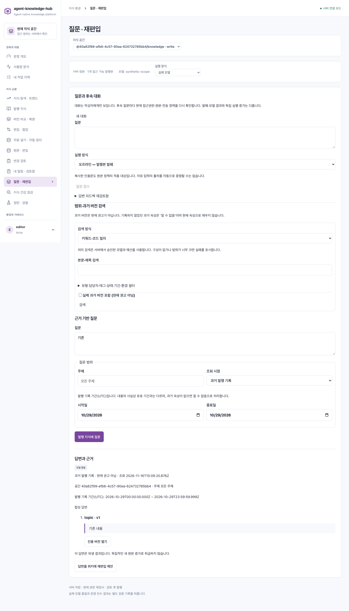
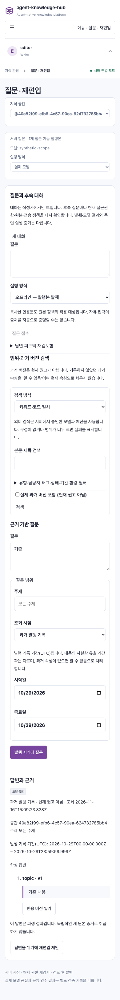

# Question scope browser evidence

- Actual Chromium against the built app and authenticated native PostgreSQL/OIDC/CSRF/runtime HTTP services. All identities, documents, claims and provider replies are synthetic fixtures. The provider is real loopback HTTP with the configured synthetic-scope response model; this is not company model quality or operational acceptance.
- `scope-1440.png`: 1440 × 1000 viewport, full-page capture. `scope-390.png`: 390 × 1000 viewport, full-page capture. Both submit a historical question for the same UTC publication day, reload the protected stored answer, and show its actual space/topic/period/asOf alongside exact v1 evidence and the not-current-recommendation label.
- Browser assertions verify actual viewport width, no horizontal document overflow, accessible scope controls and successful historical answer after real authenticated submission. Topic suggestions use currently admitted categories; a historical category can be typed explicitly.
- Reproduction: build once with Node24, then `node scripts/test-server.mjs server/runtime/question-scope-http.test.ts` with the disposable TEST_DATABASE_URL, AKH_SCOPE_SCREENSHOT_DIR and AKH_PLAYWRIGHT_MODULE. The runner creates a unique per-file DB and never migrates/drops the base database. Do not rebuild during capture.
- The screenshot-only synthetic pool uses max=20, as in the prerequisite evidence. It does not reproduce, fix or disprove the separately tracked pool6 identity-projection deadlock. Native non-screenshot HTTP tests retain the standard fixture pool.

