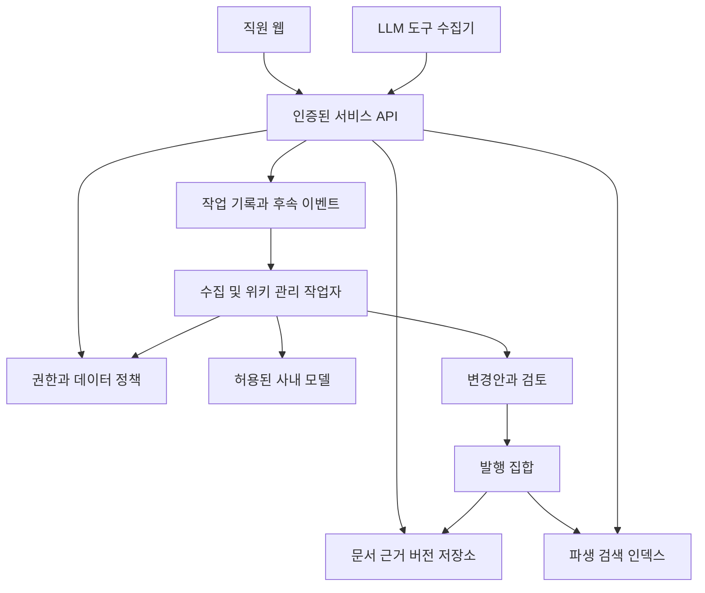

# LLM 사내 위키 설계 검토

기준일 2026년 10월 26일

직원들이 LLM으로 만든 조사·설계·개발·실험·문제 해결 결과를 회사 지식으로 축적하고, 다음 사람과 에이전트가 재사용하는 사내 서비스를 설계한다. 개인 수집함, 팀 지식, 전사 공식 지식은 하나의 제품 안에서 다른 공개 범위와 검토 책임을 가진다. Daily 및 Weekly 매니저는 같은 근거·권한·버전·발행 규칙에 따라 위키를 정비한다.

설계 결론은 **검증한 구성요소를 재사용하되, 사내 권한과 근거 계보 및 변경 발행은 서비스가 직접 책임지는 것**이다. 공개된 LLM 위키 전체를 그대로 배포하면 이 목표를 충족한다고 보기 어렵다. 특정 저장소의 전면 포크를 확정하는 대신 모듈별로 채택하며, 조건을 통과한 기반 제품은 별도 재평가할 수 있다.

## 검토 범위

공개 저장소 6개의 고정 커밋, 파일 트리, 36개 파일을 표본으로 읽었다. 파일별 경로·커밋·블롭 SHA와 읽기 상태는 source-audit.json에 있다. 후보 저장소의 테스트·운영 인스턴스를 실행한 것은 아니다. 따라서 아래는 제품·설계 검토와 표본 정적 검토이며, 침투 테스트·전체 코드 감사·성능 또는 복구 검증을 대신하지 않는다.

사내 IdP 설정, 자료 등급, 실제 모델 성능, 사용자 규모와 운영 인력은 아직 확정되지 않았다. 이 값에 의존하는 성능 및 비용 수치는 제안 목표로 표시하고 구현 후 실제 환경에서 검증한다.

## 검토 관점별 결론

| 관점 | 결정 및 요구사항 반영 |
| --- | --- |
| 제품 가치 | 문서 생성량보다 검증된 재사용과 반복 조사 감소를 본다. 산출물과 위키를 다른 개체로 둔다. |
| 초기 진입 | 개발 플랫폼 문제 해결 사례로 시작할 수 있지만 데이터 모델을 개발 문서 전용으로 제한하지 않는다. |
| 개인과 조직 | 개인 수집함은 기본 비공개다. 팀 공유와 전사 공식화는 각각 명시적인 결정이다. |
| 수집 경로 | 도구별 세션과 산출물 수집을 공통 계약으로 정규화한다. 모델 게이트웨이 로그만으로 업무 완료를 판단하지 않는다. |
| 업무 방해 | 결과를 다시 작성하게 하지 않고 선택 등록·수집 제안·초안 검토로 참여 부담을 줄인다. |
| 근거 신뢰 | LLM의 진술과 실행 증거를 구분한다. 독립 근거 수를 단순 페이지 수로 계산하지 않는다. |
| 적용 범위 | 환경·버전·시행일·예외를 보존한다. 조건이 다른 결과를 하나로 덮어쓰지 않는다. |
| 공식성 | 공유된 경험과 공식 기준을 분리한다. 전사 공식 기준은 지정 담당자가 발행한다. |
| 지식 충돌 | 최신 자료·다수 의견이 언제나 정답이라는 규칙을 두지 않는다. 충돌을 남기고 확인한다. |
| 권한 | 원본과 파생 문서·검색·답변·첨부·이전 버전에 같은 정책을 적용한다. |
| 공유 | 링크 전달과 권한 부여를 분리한다. 최신본과 고정 버전 링크, 만료·철회·하위 페이지 범위를 지원한다. |
| 편집과 협업 | 자동 저장·충돌·댓글·초안·발행본을 갖춘다. AI는 별도 수정 주체로 기록한다. |
| 버전 | 문서뿐 아니라 원본·정책·프롬프트·매니저 실행·발행 집합을 추적한다. |
| 자동 관리 | Daily는 증분 정리, Weekly는 통합과 점검 중심이다. 변경이 없으면 버전을 만들지 않는다. |
| 작업 안정성 | 중복 전달·중단·재시도를 전제로 멱등 처리하고 수락한 작업의 누락을 방지한다. |
| 일관성 | 의존 문서는 같은 발행 집합으로 노출한다. 검색 인덱스는 진실의 원천으로 두지 않는다. |
| AI 보안 | 문서와 도구 결과는 비신뢰 입력이다. 서버가 권한과 도구 범위를 강제한다. |
| 개인정보와 반출 | 수집 목적·공개 범위를 고지하고 비밀·불필요한 개인 정보를 제외한다. 숨은 추론은 수집 대상에서 제외한다. |
| 데이터 생애주기 | 원본 보존은 무기한 불변을 뜻하지 않는다. 정책상 삭제·보존 예외와 파생 영향 처리를 제공한다. |
| 검색 품질 | 한글·약어·코드 식별자·조건별 평가셋으로 검증한다. 벡터 검색만 도입해 완료로 보지 않는다. |
| 사용자 경험 | 위키 탐색을 주 화면으로 두고, 채팅·관리·검토는 목적별 진입점으로 둔다. |
| 가용성 | 모델이 멈춰도 위키 읽기와 일반 검색은 유지한다. 읽기 경로와 정기 AI 작업을 분리한다. |
| 배포와 복구 | DB·파일·키·정책·삭제 기록이 함께 복구돼야 한다. 백업 존재보다 실제 복원을 확인한다. |
| 비용 | 모델·임베딩·변환·스토리지·백업·검토 인력·운영 인력을 따로 추적한다. |
| 재사용과 공급망 | 라이선스·구현 범위·실제 도구 포맷·업그레이드 경계를 검증한 모듈만 가져온다. |
| 조직 운영 | 담당자 부재·퇴사·조직 개편·검토 지연·지원 요청까지 제품 운영 범위에 포함한다. |

## 재사용 후보 검토

후보의 이름이나 테스트 파일 수는 운영 적합성을 보장하지 않는다. 아래의 판단은 지정 커밋과 선택 파일 범위에 한한다.

| 후보 | 고정 커밋 앞자리 | 확인한 재사용 가치 | 중요한 제약 | 결정 |
| --- | --- | --- | --- | --- |
| Pratiyush/llm-wiki | b1088890ee07 | 어댑터 공통 인터페이스, 산출물 정규화, 구조 검사 및 로컬 작업 흐름 | OpenCode 수집기의 파일 위치·JSONL 전제가 현재 공식 문서의 SQLite 저장과 다르다. 두 의미 검사 규칙은 구조 검사 수준이다. | 어댑터 계약·결정적 lint를 분리 검토. 현재 OpenCode 수집기와 의미 검증 기능은 그대로 채택하지 않음. |
| hugogu/next-wiki | 453e9255d3f8 | 초안·버전·권한 검사·AI 제안·예약 작업·운영 문서 구조 | 표본 권한 모델은 전역 역할과 공개 등급 중심. 표본 제안 적용은 태그·속성·메타데이터 범위이며 항목별 적용이다. | 제품 설계 참고 및 격리 가능한 모듈 후보. 조직 ACL·본문 변경·발행 일관성 보완 없이 전체 기반으로 확정하지 않음. |
| lucasastorian/llmwiki | 9dc372f79707 | MCP 자료 읽기·쓰기, 로컬·호스팅 저장소 경계, 원본 연결 | 로컬 인증 제공자는 단일 사용자 전용. 공유 스키마는 링크 토큰 공유와 공개 모델을 포함한다. | MCP 계약 및 저장소 추상화 참고. 로컬 모드를 사내 다중 사용자 배포로 사용하지 않음. |
| ddsyasas/llm-wiki | e8dd69ebba0d | Ingest·Query·Lint UX와 출처 연결, 사람 대화의 위키 편입 | 아키텍처 문서는 단일 Node 프로세스와 별도 작업자 없는 V1을 설명한다. | 관리 UX·규칙 참고. 멀티 사용자·작업 안정성 기반으로 그대로 사용하지 않음. |
| Docmost | 6d117f8c52e5 | 편집·공유·협업·버전 기능과 상세 공유 처리 참고 | AGPL 코어와 EE 경계가 있으며 SSO·페이지 세부 권한·감사 등 필요한 기능의 에디션을 구분해야 한다. | 기존 제품 연동 또는 계약 가능한 기반 대안. EE 코드를 자유 재사용 대상으로 보지 않음. |
| Onyx | 616a4b1a9c75 | 조직 검색·커넥터·AI 컨텍스트 계층 | MIT 영역과 EE 영역이 분리돼 있고 원본 사용자 권한 반영은 공식 문서상 EE 기능이다. | 검색 연동 대안. 위키 작성·검토·관리 전체 엔진을 대신하는 것으로 보지 않음. |

### 표본 코드에서 확인한 차이

**F01 수집기 지원은 실제 도구 포맷으로 검증해야 한다.** Pratiyush의 OpenCode 어댑터는 config 경로의 JSONL을 탐색한다. 현재 OpenCode 공식 문제 해결 문서는 share 경로와 opencode.db를 설명한다. 따라서 지원한다고 표기된 사실만으로 현재 배포 버전에 작동한다고 할 수 없다. 실제 사내 도구 버전의 익명화 fixture로 호환성 계약을 검증해야 한다. COL-003·COL-004·INT-007에 반영했다.

- [어댑터 소스](https://github.com/Pratiyush/llm-wiki/blob/b1088890ee0743810a92577aecad946c6b3eb2d2/llmwiki/adapters/contrib/opencode.py#L1-L76)
- [현재 OpenCode 저장소 설명](https://opencode.ai/docs/troubleshooting/)

**F02 의미 검사라는 명칭과 실제 구현 범위를 구분해야 한다.** contradiction_detection은 이미 작성된 Contradictions 절을 찾고, claim_verification은 주장 절과 출처 표기의 존재를 점검한다. 두 파일의 표본은 실제로 근거 내용이 주장을 지지하는지 검증하는 구현이 아니다. 구조 검사로는 유용하지만 의미 검증과 신뢰도 산정은 별도 구현·평가가 필요하다. KNO-002·KNO-003·EVA-002·EVA-005에 반영했다.

- [상충 검사 소스](https://github.com/Pratiyush/llm-wiki/blob/b1088890ee0743810a92577aecad946c6b3eb2d2/llmwiki/lint/rules/contradiction_detection.py)
- [근거 검사 소스](https://github.com/Pratiyush/llm-wiki/blob/b1088890ee0743810a92577aecad946c6b3eb2d2/llmwiki/lint/rules/claim_verification.py)

**F03 승인 흐름이 있어도 본문 변경의 완전한 검토·발행은 별개다.** next-wiki의 표본 제안 적용기는 태그, 페이지 제목·경로 및 메타데이터 변경을 적용한다. 항목을 순서대로 처리하고 개별 결과를 기록한다. 이 기능만으로 여러 본문의 의존 변경을 하나의 발행 상태로 공개한다고 간주할 수 없다. VER-007·REV-004부터 REV-008까지 반영했다.

- [제안 적용 소스](https://github.com/hugogu/next-wiki/blob/453e9255d3f88028b08658b7fa55e09f5e15dcd9/apps/web/src/server/services/ai-tool-proposals.ts#L330-L450)

**F04 조직 권한 모델은 추가 설계가 필요하다.** next-wiki의 표본 권한 코드는 admin/editor/reader와 public/registered/restricted 및 공간 종류를 평가한다. 이 표본은 회사의 부서·그룹별 문서 ACL 및 다중 원본 권한 교집합을 충족하는 근거가 되지 않는다. IAM·ACL 전체에 반영했다.

- [권한 소스](https://github.com/hugogu/next-wiki/blob/453e9255d3f88028b08658b7fa55e09f5e15dcd9/apps/web/src/server/permissions/index.ts#L162-L218)

**F05 작업 수락과 큐 등록의 실패를 구분해야 한다.** next-wiki의 runtime 표본은 작업 큐가 준비되지 않은 경우 enqueue를 no-op으로 처리하는 경로를 설명한다. 호출부 전체를 실행 검증하지 않았으므로 데이터 누락 결함으로 단정하지 않는다. 이 서비스에서는 수락한 작업을 DB와 후속 이벤트에 남기고 큐 중단을 사용자·운영자가 알 수 있어야 한다. JOB-001·JOB-007·OPS-006에 반영했다.

- [작업 런타임 소스](https://github.com/hugogu/next-wiki/blob/453e9255d3f88028b08658b7fa55e09f5e15dcd9/apps/web/src/server/jobs/runtime.ts#L80-L109)

**F06 로컬 전용 인증은 사내 인증을 대신하지 않는다.** lucasastorian의 로컬 인증 제공자는 요청마다 고정 사용자 ID를 반환하는 단일 사용자 경로다. 이는 해당 모드의 설계 특성이며 호스팅 모드 전체의 인증 부재를 뜻하지 않는다. 사내 배포에서는 실제 IdP·그룹·서비스 주체 검증이 필요하다. IAM·ACL-001에 반영했다.

- [로컬 인증 소스](https://github.com/lucasastorian/llmwiki/blob/9dc372f7970754b7d0f5cd0b5d1fa706fa738a78/api/infra/auth/local.py)
- [공유 스키마](https://github.com/lucasastorian/llmwiki/blob/9dc372f7970754b7d0f5cd0b5d1fa706fa738a78/supabase/migrations/006_kb_sharing.sql)

**F07 단일 프로세스 제품도 참고할 수 있지만 운영 경계를 가져오면 안 된다.** ddsyasas 문서의 V1은 단일 Node 프로세스에서 장기 작업을 처리한다. 사내 서비스는 대량 수집·검색·대화·정기 정리의 자원과 장애를 분리한다. JOB-009·OPS-010에 반영했다.

- [아키텍처 문서](https://github.com/ddsyasas/llm-wiki/blob/e8dd69ebba0dc7c395c1b8217bb1c30c14e8c84c/docs/02-architecture.md)

**F08 공개 소스와 에디션 경계를 구분해야 한다.** Docmost와 Onyx는 공개 코어 외에 별도 라이선스 영역을 가진다. 필요한 기능을 API로 연동할지, 적법하게 사용할 수 있는 코드를 수정할지, 다른 구성요소로 구현할지는 기능별로 결정한다. 구체적인 배포·변형의 라이선스 의무는 회사의 오픈소스 절차에 따라 확인하며 이 검토가 법률 판정을 대신하지 않는다. SEC-012·EVA-009에 반영했다.

- [Docmost 라이선스 및 에디션](https://docmost.com/docs/)
- [Docmost EE 영역 라이선스](https://github.com/docmost/docmost/blob/6d117f8c52e54e810d5931f153eb2d31c904efb3/apps/client/src/ee/LICENSE)
- [Onyx 라이선스 경계](https://github.com/onyx-dot-app/onyx/blob/616a4b1a9c75cc07e9645069c672f3e8fb029ca8/LICENSE)
- [Onyx 커넥터 권한 설명](https://docs.onyx.app/overview/core_features/connectors)

## 재사용 방법의 결정

| 방법 | 장점 | 비용과 위험 | 판단 |
| --- | --- | --- | --- |
| 한 제품 전체 포크 | 초기에 화면과 기능을 빠르게 확보 | 권한·발행 모델 변경이 넓게 퍼질 수 있고 업스트림 병합 부담이 커짐 | 표본 검토만으로 확정하지 않음 |
| 기존 위키에 외부 관리 엔진 연동 | 문서 편집·협업을 활용 | API·버전·권한·승인·원자 발행 제약과 에디션 확인 필요 | 사내 기존 위키가 있거나 계약 가능한 경우 우선 타당성 검증 |
| 모듈 단위 재사용 | 권한과 근거 계약을 일관되게 설계 가능 | 제품 연결부와 운영 기능을 직접 완성해야 함 | 현재 기준 권고 |
| 모든 기능 자체 구현 | 완전한 변경 통제 | 편집기·인증·협업까지 불필요한 개발과 검증 부담 | 채택하지 않음 |

재사용 후보는 편집기 OSS 코어, 공동 편집 엔진, 사내 IdP, 데이터베이스, 오브젝트 저장소, 지속 작업 엔진, 렌더링·파싱·파일 변환, 관측 도구다. 예를 들어 Tiptap은 MIT 편집기 코어와 별도의 유료·관리형 영역을 구분한다. 라이브러리 이름만으로 모든 확장 기능까지 무료 재사용 가능하다고 판단하지 않는다.

- [Tiptap OSS와 제품 경계](https://tiptap.dev/open-source-to-platform)

각 채택 모듈은 고정 버전과 라이선스, 수정 범위, 계약 테스트, 보안 패치 담당자, 업그레이드 정책, 교체 경로를 기록한다. 변경이 필요한 코드가 권한·발행·저장 모델 전반으로 번지면 전체 포크보다 모듈 대체를 우선한다. 최종 프레임워크와 라이브러리 버전은 요구사항 충족 시험 후 고정한다.

## 권고 구조

초기 운영은 하나의 회사 경계를 우선한다. 개인·팀·전사 공간을 지원하되 외부 고객용 다중 회사 SaaS, 결제·마켓플레이스·익명 공개 서비스는 기본 범위에 넣지 않는다. 조직 경계는 모든 데이터와 호출에 유지해 이후 확대 시 전면 재설계를 피한다.

제품 코어는 모듈 단위로 나눈 단일 애플리케이션을 우선하고 장기 작업자는 별도 프로세스로 둔다. 데이터베이스·파일·인덱스·모델·작업 큐를 구분하며 서비스 수를 늘리는 것을 목표로 하지 않는다.

권한은 API 경로뿐 아니라 검색 결과 출력·모델 전송·파일 다운로드·작업 반영 시점에도 검사한다. DB와 파일 저장소가 원본이고 검색·그래프·임베딩은 다시 만들 수 있는 파생 데이터다. Git은 코드 및 선택적인 문서 미러에 활용할 수 있지만, 그것만으로 사내 권한·대화·첨부·검토·감사를 관리하지 않는다.

### 주요 개체

| 개체 | 핵심 내용 |
| --- | --- |
| 사용자 그룹 서비스 주체 | 사내 식별자, 역할, 활성 상태, 권한 범위 |
| 공간과 접근 정책 | 소유 조직, 개인·팀·전사 성격, 독자·편집자·검토자 |
| 산출물과 원본 버전 | 작성자, 도구, 프로젝트, 내용 해시, 검증 증거, 수집·발생 시점 |
| 문서와 문서 버전 | 고유 ID, 본문, 속성, 보호 구간, 기준 버전 |
| 근거 연결 | 주장 위치, 원본 버전, 적용 조건, 파생 계보, 접근 제한 |
| 변경 묶음과 검토 | 기준 버전, 항목 의존성, 근거, 검토자, 결정 |
| 발행 집합 | 동시에 유효한 문서 버전 집합, 발행 주체, 시행일 |
| 공유 권한과 링크 | 대상, 범위, 버전 고정, 만료, 철회 |
| 관리 규칙과 작업 | 일정, 규칙·모델 버전, 실행 주체, 예산, 심박, 체크포인트 |
| 감사와 보존 기록 | 접근·발행·반출·삭제 사건, 삭제 재적용용 기록 |

본문·버전·근거·발행은 분리한다. 그래야 초안 수정이 발행본에 바로 보이지 않고, 새 모델 결과도 검토 전에는 기존 회사 기준을 바꾸지 않는다.

### 상태와 발행

산출물은 개인 수집함 → 공유 확인 → 편입 대기 → 처리 중 → 변경안 생성으로 진행한다. 실패·제외·철회는 별도 상태다. 변경안은 검토 대기 → 수정 요청 또는 승인·반려 → 적용 → 발행으로 진행하며 적용 실패·충돌·대체됨을 구분한다.

승인은 변경안 내용 해시와 대상 기준 버전에 연결한다. 적용 시점에 권한과 기준 버전을 다시 확인한다. 의존한 변경은 한 DB 트랜잭션에서 발행 집합을 전환하고, 첨부·인덱스·알림 등 후속 처리는 지속 이벤트로 재시도한다. 외부 저장소까지 무조건 하나의 트랜잭션이라고 가정하지 않는다.

작업은 최소 한 번 전달될 수 있다는 전제로 멱등 처리한다. 정확히 한 번의 모델 실행을 약속하기보다 중복 실행이 문서 중복 발행과 권한 오염으로 이어지지 않게 한다. 재현은 입력과 변경의 추적을 뜻하며 같은 모델이 동일 문장을 다시 생성한다는 보장이 아니다.

## 권한과 근거 원칙

1. 초기 구현은 페이지 단위로, 사용한 모든 제한 원본의 독자 교집합에만 합성 내용을 제공한다. 읽을 수 없는 근거가 섞인 본문을 링크만 가려서 공개하지 않는다.
2. 더 넓게 공유하려면 별도 정제본과 검토된 공개 결정을 만든다. 민감정보 검사만으로 비밀 해제가 이뤄지지 않는다.
3. 내부 권한 철회는 다음 보호 응답 전에 반영한다. 외부 원본의 변경은 동기화 지연이 있으므로 신선도 상한과 초과 시 제한 동작을 정한다.
4. 저장된 대화·답변·알림·검색 캐시도 재조회 시 현재 권한을 적용한다. 이미 사람이 내려받은 사본을 기술적으로 회수할 수 있다고 약속하지 않는다.
5. 과거 내용 복원은 현재 권한을 되돌리지 않는다. 삭제 전 백업 복구에서도 삭제·철회 기록을 재적용한 후 서비스를 연다.

## 매니저의 운영 원칙

Daily는 신규 산출물과 영향받은 페이지를 증분 처리한다. Weekly는 관련 주제의 통합·충돌·지식 공백과 검토 기한을 점검한다. 문서 전체를 매일 다시 읽는 방식은 기본으로 삼지 않는다. 전체 점검은 비용과 범위를 제한한 별도 작업이다.

자동 반영은 의미가 바뀌지 않는 것으로 명시한 작업에만 허용한다. 링크 수정도 다른 문서를 가리킬 수 있으므로 대상 ID와 접근 범위를 검증한다. 본문 의미·공식 기준·공개 범위·삭제 변경은 검토 대상으로 둔다.

매니저는 수동 편집과 보호 구간을 존중하고 반려 이유를 보존한다. 새 근거가 없으면 같은 제안을 반복하지 않는다. 작업별 토큰·시간·비용·변경량 한도를 두고 회차별 발견·제안·적용·실패를 확인할 수 있게 한다.

## 위험과 대응

| 위험 | 발생 예 | 대응과 검증 |
| --- | --- | --- |
| 근거의 순환 | AI 답변을 다시 등록해 신뢰도가 부풀어 오름 | 원본 계보 및 독립 근거 구분, AT17·AT19 |
| 지식 오염 | 그럴듯한 LLM 결과가 공식 기준으로 굳어짐 | 검증 상태 및 공식 발행 분리, AT17·AT18 |
| 권한 누출 | 제한 자료를 요약한 문서가 전사 공개됨 | 파생 ACL과 정제본 검토, AT04·AT05 |
| 철회 지연 | 인덱스·캐시에 예전 권한이 남음 | 출력 전 재검사·정책 버전·신선도 제한, AT06 |
| 과거 정보 부활 | 버전·백업 복원으로 비밀이 다시 공개됨 | 현재 ACL과 삭제 기록 재적용, AT07·AT26 |
| 간접 지시 주입 | 원본에 관리자 도구 실행 지시 포함 | 서버 도구 범위와 모델 전송 제한, AT21·AT31 |
| 동시 수정 손실 | 사람 수정 뒤 AI가 오래된 결과를 저장 | 기준 버전 검사와 충돌 해결, AT10·AT11 |
| 부분 발행 | 관련 문서 중 절반만 바뀜 | 의존 발행 집합과 후속 이벤트, AT12·AT13 |
| 조용한 누락 | 큐 중단인데 등록 성공으로 응답 | 지속 작업 수락 기록과 재처리, AT22 |
| 검토 피로 | 작은 수정 수백 건이 승인함을 채움 | 최소 변경과 묶음 검토, AT18·AT25 |
| 자원 고갈 | 야간 작업이 대화 GPU와 DB를 점유 | 작업 격리·할당량·역압, AT20·AT23 |
| 모델 교체 퇴행 | 새 모델이 근거 없는 종합을 만듦 | 고정 평가셋과 점진 적용·복귀, AT34 |
| 운영자 의존 | 최초 개발자만 장애를 복구함 | 인계·운영 도구·복원 훈련, AT26·AT33 |
| 포크 유지비 | 업스트림 보안 패치를 적용하기 어려움 | 변경 경계·고정 버전·담당자·교체 계획, AT29 |
| 개인정보 감시화 | 개인 대화가 의도 없이 조직에 공개됨 | 선택 수집·개인 초안·수집 고지·목적 제한, AT14·AT15 |
| 지식 방치 | 담당자 퇴사 후 공식 문서가 계속 유효함 | 소유권 인계·기한·제공 상태 관리, AT02·AT27 |

웹 보안은 [OWASP ASVS](https://asvs.owasp.org/)를 검증 항목의 출발점으로 삼고, AI는 [OWASP의 프롬프트 주입 위험](https://genai.owasp.org/llmrisk/llm01-prompt-injection/) 등을 별도 위협 모델에 포함한다. 표준 이름을 넣는 것만으로 준수 또는 안전을 인증했다고 보지 않는다.

## 운영 목표 제안

| 항목 | 초기 제안 | 측정과 조건 |
| --- | --- | --- |
| 검증 데이터 | 계정 1000, 동시 활성 100, 발행 페이지 10만, 버전 100만 | 실제 사내 규모 확인 후 확정하는 부하 가정 |
| 기본 기능 가용성 | 월 99.9% | 문서 읽기·일반 검색·수동 편집 성공률, 측정 위치와 제외 조건 명시 |
| 문서 읽기 | p95 1초 이하 | 서버 종단, 대용량 첨부 다운로드 제외 |
| 일반 검색 | p95 2초 이하 | 정의된 질의셋·데이터·부하, 캐시 유무 보고 |
| AI 응답 | 첫 유효 응답 p95 8초, 완료 p95 45초 | 지정 모델·입출력 길이·부하에서 검증 필요 |
| 편입 지연 | 1MiB 이하 텍스트의 변경안 생성 p95 5분 | 수락 시점부터, 입력량과 실패 포함 기준 명시 |
| 색인 반영 | 발행 후 p95 60초 | 철회와 접근 차단은 색인 완료를 기다리지 않음 |
| 외부 권한 신선도 | 상한 5분 | 원본 API·이벤트 가능성 확인 필요, 초과 시 제한 |
| 재해 복구 | RPO 15분, RTO 4시간 | DB·원본·첨부·키·정책·삭제 상태의 일관된 복구 실측 |

이 수치는 공급 제품의 보장이나 실측 결과가 아니다. 특히 AI 지연과 편입 처리량은 사내 모델의 처리 용량과 동시에 검증해야 한다. 월 가용성은 운영 계측으로 지속 확인하며 짧은 부하 테스트만으로 달성했다고 판정하지 않는다.

PostgreSQL의 WAL 기반 시점 복구는 DB 복구 수단으로 활용할 수 있지만 파일·키·설정과의 일관된 복구까지 별도로 설계해야 한다. [공식 PITR 문서](https://www.postgresql.org/docs/current/continuous-archiving.html)를 참조한다.

월간 총비용은 모델 및 임베딩 호출 + 변환 처리 + 앱·DB·검색 자원 + 파일·버전·백업 보관 + 관측 도구 + 직원 검토 시간 + 운영·업그레이드 시간으로 계산한다. 사내 GPU도 무료로 간주하지 않고 배정 용량과 다른 업무의 기회비용을 기록한다. 검토 대기 건수와 건당 검토 시간을 함께 측정한다.

## 실제 운영까지의 단계

단계는 제품 요구사항을 줄이는 구실로 사용하지 않는다. 첫 실제 운영에는 requirements.md의 필수 항목과 해당 인수 시나리오가 충족돼야 한다.

| 단계 | 결과 | 완료 조건 |
| --- | --- | --- |
| 설계 기준 | 개체·권한·발행·수집·운영 계약과 재사용 경계 | 핵심 미결정 항목 확정, 채택 모듈의 라이선스와 계약 검증 |
| 기능 통합 | 두 사용자와 실제 도구 하나의 수집부터 재사용까지 동작 | 핵심 흐름과 실패 경로를 같은 제품 코드로 검증 |
| 운영 준비 | SSO·감사·관리 도구·관측·복구·업그레이드 완료 | 필수 요구사항 통과, 중대 보안 결함 해소, 복원 및 운영 인계 훈련 완료 |
| 첫 사내 운영 | 제한된 실제 조직에서 지속 사용 | 실제 SLO·비용·검토 부담·재사용 결과 관측 및 결함 해결 |
| 전사 확대 | 추가 도구·자료원·조직 규모 지원 | 확대 부하와 권한 동기화 및 해당 확장 기능 검증 |

## 아직 사내 환경에서 확정할 사항

다음 항목은 외부 조사로 추정 확정하지 않는다. 구현을 막지 않는 부분은 인터페이스와 보수적 기본값으로 진행할 수 있지만 운영 개시 전에는 담당자와 결정을 기록해야 한다.

| 항목 | 초기 방향 | 결정 시점과 책임 |
| --- | --- | --- |
| 최초 연동 도구 | 실제 사용량이 높은 도구 하나, OpenCode는 현재 저장 포맷부터 확인 | 수집 구현 전, 제품·연동 담당 |
| 기존 사내 위키 | 기존 시스템과의 연동 가능성과 데이터 소유권 확인 | 기반 확정 전, 제품·운영 담당 |
| 인증과 그룹 | 사내 IdP의 안정적인 식별자·그룹 연동 | 보안 계약 확정 전, IAM 담당 |
| 자료 등급 | 등급별 모델·반출·공개 정책 | 실제 자료 수집 전, 보안·데이터 담당 |
| 독자와 승인 범위 | 개인·팀·전사 책임 및 공식 발행자 | 검토 정책 확정 전, 지식 담당 |
| 규모와 보존 | 사용자 문서 버전 파일 크기 연간 증가 및 보존 기간 | 부하·복구 시험 전, 운영 담당 |
| 모델 용량 | 작업별 모델과 동시 실행·시간·예산 한도 | AI 통합 검증 전, 모델 운영 담당 |
| 운영 인력 | 지원 시간 긴급 대응과 대체 담당자 | 첫 운영 전, 서비스 책임자 |
| 라이선스 정책 | AGPL 및 상용 에디션 허용 여부와 패치 유지 방식 | 코드 채택 전, 회사 오픈소스 절차 담당 |
| 수치 목표 | 부하 기준 품질 임계값 SLO 복구 예산 | 인수 기준 확정 전, 제품·운영·보안 공동 |

## 요구사항 연결

상세 기능·비기능 요구사항과 항목별 수용 기준은 requirements.md, 기계 판독용 목록은 requirements.json, 실패·복구를 포함한 인수 시나리오는 acceptance-tests.md에 있다. 공개 소스 표본 검토의 파일별 근거는 source-audit.json에 있다.
