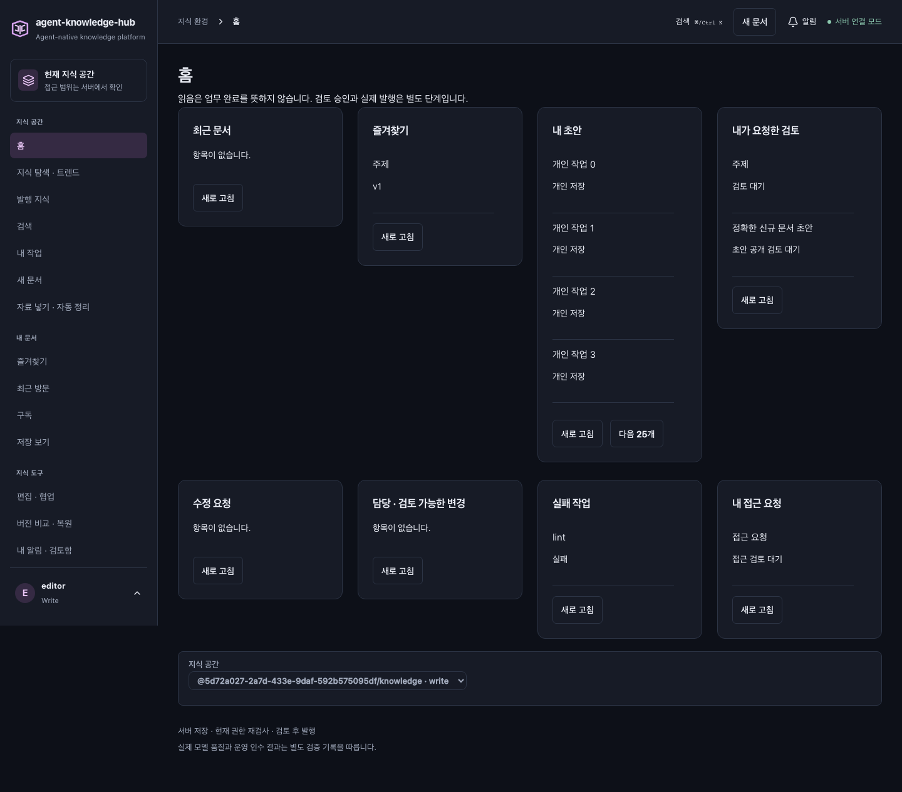
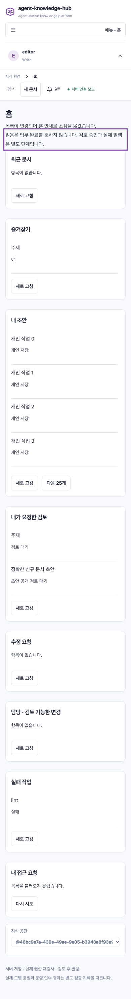

# C4 개인 홈·내 작업 — 실제 UI 검증

최종 제품 fingerprint: `2339ac55d3eb86a5d3c9d5a4915d0031fe9143276a59a235acbc729599d43f98`. 최종 runtime 시작 `2026-11-17T12:07:54.716Z`, frontend 시작 `2026-11-17T12:07:56.347Z`. Node24.22.2/macOS, PostgreSQL17 합성 전용 DB, Chromium158 headless, Asia/Seoul. 실제 OIDC 대신 명시적 loopback actor adapter를 사용한다. 응답은 실제 canonical HTTP에서 받아 그대로 전달하며, 성공 DTO를 조작하지 않는다.

1440×1000/390×844 × light/dark의 네 조건 모두 exit0, 조건별11상태 총44PNG와 `browser-results.json`. 상태는 empty/loading/home/keyboard-bottom/partial-error/tasks/page-draft-resume/new-draft-resume/other-owner-denied/acl-revoked/account-switched다. Dark/light dataset 값을 매 캡처 확인했고 document 수평 overflow와 pageerror는0이다.

- Loading은 실제 backend 응답을 받은 후 전달만 지연한다. Empty는 성공한 빈 개인 공간이다.
- Partial error는 소유 합성 DB에서 `workflow_access_requests`를 잠시 rename한 실제42P01이다. 다른 요청2개·초안25개가 유지되고, 복구 후 `widget=accessRequests`만 재시도한다. native 회귀는 disclosure 테이블 장애와 공통 authority 장애도 구별한다.
- Home/내 작업은 문서 본문 open 없이 metadata만 조회하며 초기 `workflow_activity.kind=recent`가0이다. 실제 기존 문서 초안 open 이후에만 recent가 생긴다.
- 초안25개가 DOM에 유지된다. 실제 Tab24회로 native scroll 안의25번째 링크, 다음 Tab으로 새로고침/진짜 continuation, 다음 Tab으로 위젯 밖에 도달했다. Next 뒤 오래된 d27 링크를 Enter로 열어 정확한 ID/본문·기준v1/r1을 확인했다. 신규 page-less 초안도 실제 C6 Composer로 재개한다.
- 다른 owner 초안은 오류이며 본문이 나오지 않는다. 현재 source ACL 철회는 favorite를 제거하고 현재 DOM fallback을 유지한다. 실제 actor 전환/페이지 재진입에서 이전 개인 목록이 없어지고 새 actor 자신의 목록만 보인다. 같은 컴포넌트의 늦은 응답/주체·공간/API 세대 격리는 client 회귀가 추가 확인한다.

실행: `AKH_C4_SYNTHETIC_CAPTURE=1 TEST_DATABASE_URL=<loopback test DB> npx tsx home-runtime.ts`, frontend5194, `PLAYWRIGHT_MODULE=<installed module> node capture.mjs`. 런타임4394와 frontend5194는 최종 제품 바이트에서 새로 시작했다. `manifest.mjs --frontend-start`는 시작 시 전체 server/src/SQL/CSS/JSON·lock/config SHA를 기록하며 capture는 backend/frontend/현재 source fingerprint 일치를 확인한다. `manifest.mjs`와 `--verify`는 최종 source/harness/artifact/log를 묶는다. 비밀값을 넣지 않는다.

Terminal 로그는 줄 끝 공백/EOF 빈 줄만 정규화하며 실패·결과·본문은 보존한다. 검증 로그는 `.superpowers/sdd/2026-11-16-essential-convenience/logs/c4-*`다. 최신 `c4-final-check.log` exit0: frontend436/Node48/import16/evaluation41/requirements251/server types/build/static smoke. 최신 native `c4-final-isolation-native.log`는4파일50개 exit0(Home10/HTTP1/manual9/new-document30). 이전 corrected governance14/workflows36 및 unchanged collaboration21/personal7/personal HTTP4/jobs48의 green130개를 carry한다. 고유10파일180 범위이며 단일 최종180개 실행으로 주장하지 않는다. 이전 실패/수정 로그와 pre-isolation/pre-scroll capture는 superseded다.

`cleanup.json`은 소유 DB0/소유 profile0/4394·5194 해제, 부모PG 생존을 확인한다. 다른 세션·컨테이너는 중지하지 않았다.

한계: C6에서 재사용한 암호화 cursor 키는 process-local이며 재시작/인스턴스 전환 시 새 조회가 필요하다. 후보별25개 canonical 검사는 bounded지만 current revision SQL digest는 workspace/authority 테이블을 scan하므로 대규모 DB 비용을 검증한 것이 아니다. 기존 personal library의10,000개 cap/내부 snapshot 계약도 유지한다. 기존 WorkflowPanel의 wrapping label에는 초기 textarea 내용이 들어가므로 증거 harness는 label prefix의 유일한 editor와 정확한 본문을 확인한다. Home native nested scroll은 desktop/mobile Chromium keyboard로 확인했으며 OS·스크린리더 접근성 인증은 아니다. 실제 IdP/운영 부하·모델 의미 품질·지식 및 에이전트 효과는 미검증이고 기존 Vite chunk 경고는 남는다.

