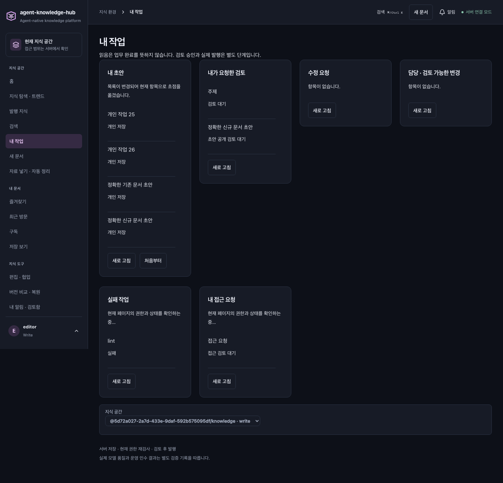
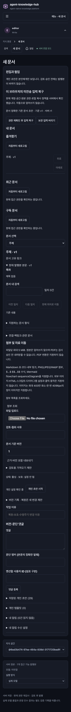

# C4 개인 홈·내 작업 — F1/F2 최종 실제 UI 검증

최신 제품 fingerprint: `be63334376c81a8cd2c5e1c88db1ba1a89e8711468ec75a51d3dd6bdada49291`. runtime 시작 `2026-11-17T15:26:08.455Z`, frontend 시작 `2026-11-17T15:26:06.919Z`. Node24.22.2/macOS, PostgreSQL17 합성 전용 DB, Chromium158 headless, Asia/Seoul. 실제 OIDC 대신 명시적 loopback actor adapter를 사용하며 실제 canonical HTTP 응답을 그대로 전달한다.

1440×1000/390×844 × light/dark 네 조건 모두 exit0. 조건별19상태 총76PNG와 `browser-results.json`을 새로 생성했다. theme dataset, 문서 수평 overflow0, pageerror0을 확인했다. 상태는 preview/empty/space-change/loading/home/keyboard-bottom/partial-error/tasks/current-page-refresh/current-page-stale/page-draft-resume/recovery-other-id/recovery-offered/recovery-restored/recovery-conflict/new-draft-resume/other-owner-denied/acl-revoked/account-switched다.

- **F1 실제 현재 페이지:** My Tasks에서25개 다음 구간의 d27 링크에 초점을 둔 채 focus·visibility 이벤트와 앱의 실제30초 interval을 각각 실행했다. 같은 cursor를 canonical API로 다시 조회하고 같은 DOM node/초점·d27을 유지한다. 실제 DB revision 변경 뒤 기존 cursor는 오류로 행을 비우고 현재 heading으로 초점을 옮긴다. 명시적 처음부터→다음으로 재진입한다. 같은 Home 컴포넌트의 양쪽 Next/refresh 경합, 오래된 주체 응답,503/403/error DTO 및 반복 background request 합치기는 별도 DOM 회귀가 확인한다.
- **F2 실제 미전송 복구:** 명시 local-copy 정책과 실제 permission grant를 사용한다. 실제 초안 POST만 network abort하여 브라우저에서 입력/캐시를 만들고 다른 d26을 열어 d27 캐시를 보존한다. 정확한 d27 URL 재진입은 온라인 identity/full-lineage/local-copy/CAS 확인 뒤 복구/버리기를 제공하고 승인 전에는 본문을 editor에 넣지 않는다. 복구 후 canonical server r2의 정확한 입력 저장을 확인한다. 다시 미전송 입력을 만들고 별도 canonical writer가 저장한 뒤 재진입하면 원래 CAS의 명시적 충돌을 보이며 서버의 winner 본문을 덮어쓰지 않는다. expired/revoked/failed validation·wrong identity·복구 직전 철회·pending unmount·명시 discard는 DOM 회귀가 추가 확인한다. 새 page-less C6 resume도 실제로 확인한다.
- **기존 흐름:** bare preview는 Overview/native API0. 실제 기본 Home 공간 전환 후 Home과 운영 aggregate 독립성을 유지한다. Home metadata는 방문을 기록하지 않고 실제 editor open 뒤에만 recent가 생긴다.25개 DOM/native scroll의 마지막 링크·Next·위젯 밖을 Tab으로 이동한다. 실제 소유 DB access-request table rename42P01은 해당 위젯만 실패시키고 복구 후 개별 retry한다. 다른 owner exact ID는 거부되고 현재 source ACL 철회·actor 전환은 기존 개인 행을 제거한다.

실행은 `AKH_C4_SYNTHETIC_CAPTURE=1 TEST_DATABASE_URL=<authorized loopback DB> npx tsx home-runtime.ts`, frontend5194, `PLAYWRIGHT_MODULE=<installed module> node capture.mjs`이다. `manifest.mjs --frontend-start`와 runtime은 시작 시 전체 server/src/SQL/CSS/JSON·lock/config SHA를 기록하고 capture는 현재 source와 일치하는지 검사한다. `manifest.mjs` 및 `--verify`가 production322·harness3·focused regression6·artifact78과 모든 scoped c4 로그를 묶는다. final manifest 자체 SHA는 task report/handoff에 기록한다.

최신 `c4-finalwave-final-focused.log`는6파일60개 exit0, `c4-finalwave-final-check.log`는frontend471/Node48/import16/evaluation41/requirements251/server types/build/static smoke exit0이다. 초기 F1/F2 RED14/16, 실제 parent reload로 autosave를 잃은 RED1/13, 반복 automatic refresh overlap RED1/11과 첫 browser 실패를 보존한다. parent-reload capture의400은 읽기 DTO updatedAt을 strict write에 넣은 harness 오류였고 쓰기 필드만 보내도록 정정했다. 실패를 성공으로 바꾸지 않는다. 이전469/470 check와 I1의447/52PNG는 과거 근거이며 현재 검증으로 재사용하지 않는다.

**Native carry:** backend bytes는 FIX_BASE f74f408과 동일하다. 이 wave에서 native suite를 재실행하지 않았다. 이전4파일50(Home10/HTTP1/manual9/new-document30)과6파일130(governance14/workflows36/collaboration21/personal7/personal HTTP4/jobs48)을 따로 carry한다. 고유10파일180이며 단일 현재180 실행이 아니다.

`cleanup.json`은 소유 DB/profile/Chrome0,4394·5194 해제와 parent PostgreSQL 생존을 확인한다. 로그는 줄 끝 공백/EOF 빈 줄만 정규화하며 실패/결과는 보존한다. 이전 I1 manifest와 전체 최종 리뷰는 `c4-finalwave-prior-manifest.log`, `c4-finalwave-review.log`에 남긴다.

한계: per-widget 현재 페이지 재검증은 화면별6/8개 요청이며 SQL revision digest는 workspace/global authority tables를 scan한다. 응답/후보 수 bounded는 DB 비용 상수가 아니다. personal snapshot10,000 cap과 process-local cursor의 재시작/멀티인스턴스 제약도 그대로다. 기존629.09/1499.04kB bundle 경고, WorkflowPanel wrapping label의 accessible name, 전체 편집 패널 길이는 후속 부채다. 실제 IdP·운영 부하·retention/restore 인수·OS IME/스크린리더·모델/지식/에이전트 품질은 검증하지 않았다. C1/C2의 unchanged review/job/access/login journey는 carry이고 C12 전체 journey 검증이 남는다. 독립 scoped re-review·exact-head CI·PR72 병합은 controller가 담당한다.

